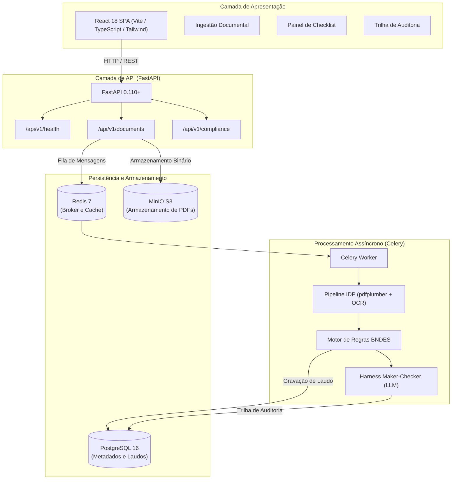

# Conform.IA BNDES - Plataforma de Conformidade Documental

[](https://github.com/conformia-bndes/conformia-platform/actions/workflows/ci.yml)
[](https://conformia-bndes.github.io/conformia-platform/)
[](https://www.python.org/)
[](https://fastapi.tiangolo.com)
[](https://react.dev/)
[](https://www.docker.com/)
[](https://www.bestpractices.dev/projects/16430)

Plataforma SaaS de Processamento Inteligente de Documentos (IDP) para verificação automatizada de conformidade cadastral, fiscal, trabalhista e regulatória em operações de crédito e investimentos no BNDES, desenvolvida para atender aos requisitos da Consulta Pública BNDES nº 01/2025.

---

## 1. Visão Geral do Projeto

A concessão de apoio financeiro pelo BNDES exige a comprovação estrita de regularidade documental por parte das empresas proponentes (certidões negativas de tributos federais, regularidade com o FGTS, certidões de falência e concordata, débitos trabalhistas e licenças socioambientais). O processo manual tradicional gera sobrecarga operacional e estende o tempo médio de análise.

O Conform.IA BNDES endereça esse desafio por meio de:

1. **Pipeline IDP Híbrido**: Extração vetorial nativa de PDFs com fallback automático para OCR Tesseract em páginas digitalizadas.
2. **Motor de Regras Declarativo**: Avaliação baseada em schemas JSON normativos com tolerância zero a pendências críticas.
3. **Harness Engineering e Padrão Maker-Checker**: Agentes de linguagem operando sob contexto estritamente delimitado com auditoria algorítmica para eliminação de alucinações.
4. **Trilha de Auditoria Imutável**: Registro cronológico e detalhado de todas as operações para compliance e prestação de contas.

---

## 2. Documentação Oficial do Projeto

A documentação técnica completa, abrangendo especificações de engenharia, matriz de requisitos e Registros de Decisão Arquitetural (ADRs), está publicada no GitHub Pages:

- **Portal de Documentação**: [https://conformia-bndes.github.io/conformia-platform/](https://conformia-bndes.github.io/conformia-platform/)

Para executar a documentação localmente com recarregamento a quente:

```bash
make docs
# Acesso local em http://127.0.0.1:8001
```

---

## 3. Arquitetura do Sistema



---

## 4. Matriz de Serviços e Portas

| Serviço      | Tecnologia                 | Porta Host      | Finalidade                                           |
| :----------- | :------------------------- | :-------------- | :--------------------------------------------------- |
| **frontend** | React 18 / Vite / Tailwind | `5173`          | Interface web para analistas de crédito do BNDES     |
| **backend**  | FastAPI / Python 3.11      | `8000`          | API RESTful, ingestão e motor de conformidade        |
| **worker**   | Celery 5 / Python 3.11     | -               | Execução assíncrona de OCR, extração e regras de IA  |
| **postgres** | PostgreSQL 16 Alpine       | `5432`          | Banco relacional para laudos, documentos e auditoria |
| **redis**    | Redis 7 Alpine             | `6380` (host)   | Broker de mensagens Celery e cache                   |
| **minio**    | MinIO (fork `pgsty/minio`) | `9000` / `9001` | Armazenamento de arquivos PDF ingeridos              |

---

## 5. Estrutura de Diretórios do Monorepo

```text
conformia-platform/
├── .agents/                      # Diretrizes de Harness Engineering e contexto de agentes
│   └── AGENTS.md                 # Limites operacionais e diretrizes agent-first
├── .github/                      # Governança, templates e integração contínua
│   ├── CODEOWNERS                # Roteamento automático de revisão por times
│   ├── PULL_REQUEST_TEMPLATE.md  # Template de PR com Definition of Done formal
│   └── workflows/                # CI por áreas, CD, publicação da documentação e release
├── backend/                      # API FastAPI e núcleo da aplicação
│   ├── app/
│   │   ├── api/v1/endpoints/     # Rotas da API (health, documents, compliance)
│   │   ├── core/                 # Configurações (pydantic-settings) e Celery
│   │   ├── db/models/            # Modelos SQLAlchemy 2.0 (Document, Compliance, Audit)
│   │   ├── idp/                  # Extração vetorial e fallback OCR Tesseract
│   │   ├── ai/                   # Abstração de LLM e validador Maker-Checker
│   │   ├── services/             # Motor de regras determinísticas e híbridas
│   │   └── main.py               # Ponto de entrada FastAPI com CORS e middleware
│   ├── tests/                    # Suíte de testes automatizados com pytest
│   └── pyproject.toml            # Dependências, empacotamento, black e pytest (versões no uv.lock da raiz)
├── docs/                         # Documentação técnica completa (MkDocs Material)
│   ├── index.md                  # Página inicial da documentação
│   ├── architecture/             # Visão geral de arquitetura e registros ADR
│   ├── bndes/                    # Análise do edital e tipologias de documentos
│   └── engineering/              # Detalhamento de IDP, motor de regras e Evals
├── docs_hooks/                   # Hooks do MkDocs (relatórios de qualidade e verificação do site)
├── evals/                        # Avaliação contínua e benchmark de regressão
│   ├── README.md                 # Métricas de recall, CER e tolerância zero
│   └── eval_pipeline.py          # Script automatizado de benchmark de regressão
├── frontend/                     # Aplicação Web SPA
│   ├── src/
│   │   ├── services/api.ts       # Cliente Axios fortemente tipado
│   │   ├── App.tsx               # Dashboard institucional com abas operacionais
│   │   └── main.tsx              # Ponto de entrada React 18
│   ├── package.json              # Dependências e scripts do frontend
│   └── vite.config.ts            # Configuração do servidor de desenvolvimento Vite
├── infra/                        # Infraestrutura conteinerizada oficial
│   ├── docker-compose.yml        # Orquestração unificada de serviços
│   ├── Dockerfile.backend        # Multi-stage Python 3.11 com Tesseract OCR e Poppler (uv)
│   ├── Dockerfile.frontend       # Multi-stage Node 20 com Vite e Nginx
│   └── nginx.conf                # Configuração de proxy reverso de produção
├── rules/
│   └── schemas/
│       ├── rule_schema.json           # JSON Schema declarativo de regras
│       └── bndes_sample_checklist.json # Checklist referencial BNDES 2025
├── scripts/                      # Utilitários de ambiente, resiliência e verificação de workflows
├── .env.example                  # Modelo de variáveis de ambiente documentadas
├── .flake8                       # Configuração global de linter Flake8
├── .gitignore                    # Regras de exclusão de artefatos locais e segredos
├── Makefile                      # Automação de comandos de desenvolvimento (uv / make)
├── mkdocs.yml                    # Configuração do gerador de documentação MkDocs
├── pyproject.toml                # Configuração raiz do monorepo e workspace Astral uv
├── uv.lock                       # Lockfile determinístico do workspace Python (uv)
└── README.md                     # Documento central de apresentação do repositório
```

---

## 6. Guia Rápido de Inicialização

### Pré-requisitos

- Docker Engine >= 24.0 e Docker Compose Plugin >= 2.20 (para `up --wait`)
- Make e Bash (no Windows, use WSL2 ou Git Bash)
- Para desenvolvimento local fora do Docker (opcional): Astral `uv` >= 0.5.0 ou Python 3.11+, e Node.js 22+ com npm >= 10

### Subir o ambiente em 3 comandos

```bash
git clone https://github.com/conformia-bndes/conformia-platform.git
cd conformia-platform

make up      # gera o .env (se não existir), constrói as imagens e espera tudo ficar saudável
make smoke   # teste de fumaça: upload -> fila -> worker -> estado da tarefa
```

`make up` executa `make env` antes: ele copia `.env.example` para `.env` trocando cada `CHANGE_ME`
por um valor aleatório. **Nenhuma credencial é versionada**; o `.env` está no `.gitignore`.

### Pontos de acesso locais

- **Frontend SPA**: [http://localhost:5173](http://localhost:5173)
- **Documentação Swagger (OpenAPI)**: [http://localhost:8000/docs](http://localhost:8000/docs)
- **Healthcheck da API**: [http://localhost:8000/api/v1/health](http://localhost:8000/api/v1/health)
- **MinIO Console**: [http://localhost:9001](http://localhost:9001) _(credenciais em `.env`)_

### Problemas comuns

| Sintoma                                              | Causa e solução                                                          |
| :--------------------------------------------------- | :----------------------------------------------------------------------- |
| `ERRO: .env desatualizado. Variaveis ausentes...`    | `.env` antigo sem chaves novas. Rode `bash scripts/setup-env.sh --sync`. |
| `Segredos nao configurados: ... CHANGE_ME`           | `.env` copiado à mão. Rode `bash scripts/setup-env.sh --force`.          |
| `password authentication failed` no Postgres / MinIO | Volumes antigos com outras senhas. Rode `make clean` e depois `make up`. |
| `port is already allocated`                          | Ajuste `*_PORT` no `.env` (ex.: `POSTGRES_PORT=5433`).                   |
| Upload retorna `503`                                 | Redis ou MinIO indisponível; confira `make ps` e `/api/v1/health`.       |

O passo a passo completo (comandos sem Make, detalhes do teste de fumaça, imagem do MinIO e demais
problemas) está no [Guia de Início Rápido](https://conformia-bndes.github.io/conformia-platform/development/quickstart/).

---

## 7. Qualidade, Testes e Evals

### Testes Automatizados do Backend

```bash
make test
# Executa a suíte de testes com pytest e relatório de cobertura (via uv run se instalado)
```

### Pipeline de Avaliação Contínua (Harness Evals)

```bash
make eval
# Executa a validação contra casos de teste com tolerância zero a falsos positivos
```

### Formatação e Linters

```bash
make lint
# Executa Flake8, Black e ESLint

make format
# Formata o código Python com Black
```

---

## 8. Governança e Regras de Contribuição

1. **Roteamento de Revisão**: Alterações estruturais são encaminhadas automaticamente aos responsáveis designados em `.github/CODEOWNERS`.
2. **Definition of Done (DoD)**: Todo Pull Request deve cumprir rigorosamente o checklist estrito em `.github/PULL_REQUEST_TEMPLATE.md`.
3. **Agentes Autônomos**: Devem operar em estrita conformidade com as diretrizes de contexto delimitado e segurança estabelecidas em `.agents/AGENTS.md`.
4. **Padrão Estilístico**: Proibição expressa de emojis em códigos, commits, templates e documentação.
5. **Planejamento**: issues, milestones e o [Project do MVP](https://github.com/orgs/conformia-bndes/projects/2) (Kanban, Roadmap e Backlog) concentram o trabalho até 05/12/2026.
6. **Ferramentas de governança**: hooks pre-commit (`make hooks`), títulos de PR em Conventional Commits, CodeQL, OpenSSF Scorecard e release-please. Detalhes em [Governança e Ferramentas](https://conformia-bndes.github.io/conformia-platform/development/governance/).
