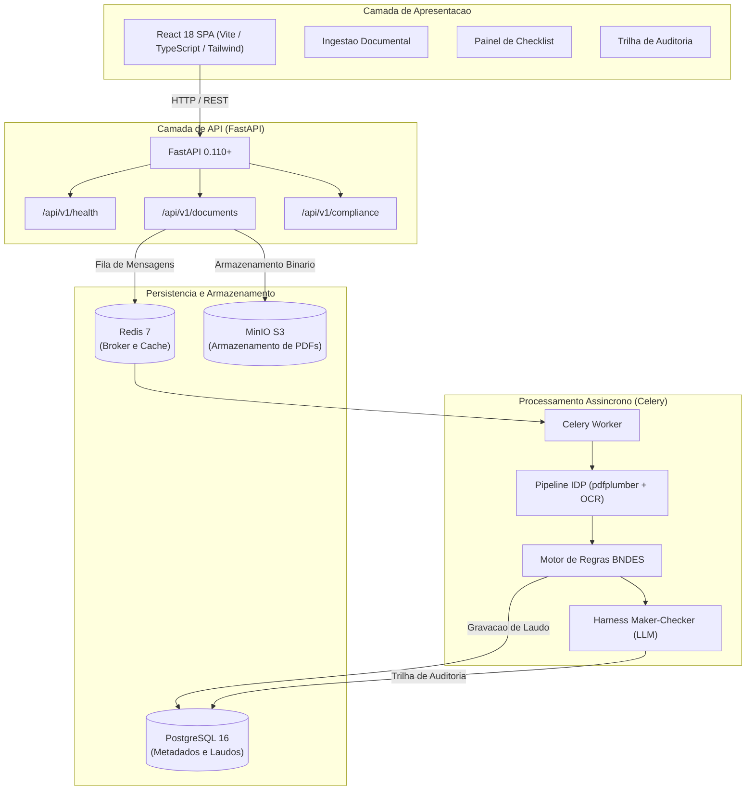

# Conform.IA BNDES - Plataforma de Conformidade Documental

[](https://github.com/conformia-bndes/conformia-platform/actions/workflows/ci.yml)
[](https://conformia-bndes.github.io/conformia-platform/)
[](https://www.python.org/)
[](https://fastapi.tiangolo.com)
[](https://react.dev/)
[](https://www.docker.com/)

Plataforma SaaS de Processamento Inteligente de Documentos (IDP) para verificação automatizada de conformidade cadastral, fiscal, trabalhista e regulatoria em operações de crédito e investimentos no BNDES, desenvolvida para atender aos requisitos da Consulta Publica BNDES no 01/2025.

---

## 1. Visão Geral do Projeto

A concessão de apoio financeiro pelo BNDES exige a comprovação estrita de regularidade documental por parte das empresas proponentes (certidões negativas de tributos federais, regularidade com o FGTS, certidões de falência e concordata, débitos trabalhistas e licenças socioambientais). O processo manual tradicional gera sobrecarga operacional e estende o tempo médio de análise.

O Conform.IA BNDES endereca esse desafio por meio de:

1. **Pipeline IDP Híbrido**: Extração vetorial nativa de PDFs com fallback automático para OCR Tesseract em páginas digitalizadas.
2. **Motor de Regras Declarativo**: Avaliação baseada em schemas JSON normativos com tolerância zero a pendências criticas.
3. **Harness Engineering e Padrão Maker-Checker**: Agentes de linguagem operando sob contexto estritamente delimitado com auditoria algoritmica para eliminação de alucinações.
4. **Trilha de Auditoria Imutável**: Registro cronológico e detalhado de todas as operações para compliance e prestação de contas.

---

## 2. Documentação Oficial do Projeto

A documentação técnica completa, abrangendo especificações de engenharia, matriz de requisitos e Registros de Decisão Arquitetural (ADRs), esta publicada no GitHub Pages:

- **Portal de Documentação**: [https://conformia-bndes.github.io/conformia-platform/](https://conformia-bndes.github.io/conformia-platform/)

Para executar a documentação localmente com recarregamento a quente:

```bash
make docs
# Acesso local em http://127.0.0.1:8000
```

---

## 3. Arquitetura do Sistema



---

## 4. Matriz de Serviços e Portas

| Serviço      | Tecnologia                 | Porta Host      | Finalidade                                           |
| :----------- | :------------------------- | :-------------- | :--------------------------------------------------- |
| **frontend** | React 18 / Vite / Tailwind | `5173`          | Interface web para analistas de crédito do BNDES     |
| **backend**  | FastAPI / Python 3.11      | `8000`          | API RESTful, ingestão e motor de conformidade        |
| **worker**   | Celery 5 / Python 3.11     | -               | Execução assincrona de OCR, extração e regras de IA  |
| **postgres** | PostgreSQL 16 Alpine       | `5432`          | Banco relacional para laudos, documentos e auditoria |
| **redis**    | Redis 7 Alpine             | `6380` (host)   | Broker de mensagens Celery e cache                   |
| **minio**    | MinIO (fork `pgsty/minio`) | `9000` / `9001` | Armazenamento de arquivos PDF ingeridos              |

---

## 5. Estrutura de Diretórios do Monorepo

```text
conformia-platform/
├── .agents/                      # Diretrizes de Harness Engineering e contexto de agentes
│   └── AGENTS.md                 # Limites operacionais e diretrizes agent-first
├── .github/                      # Governanca, templates e integracao continua
│   ├── CODEOWNERS                # Roteamento automatico de revisao por times
│   ├── PULL_REQUEST_TEMPLATE.md  # Template de PR com Definition of Done formal
│   └── workflows/
│       ├── ci.yml                # Pipeline CI com path-filtering (backend, frontend, sec)
│       └── docs.yml              # Pipeline de publicacao da documentacao no GitHub Pages
├── backend/                      # API FastAPI e nucleo da aplicacao
│   ├── app/
│   │   ├── api/v1/endpoints/     # Rotas da API (health, documents, compliance)
│   │   ├── core/                 # Configuracoes (pydantic-settings) e Celery
│   │   ├── db/models/            # Modelos SQLAlchemy 2.0 (Document, Compliance, Audit)
│   │   ├── idp/                  # Extracao vetorial e fallback OCR Tesseract
│   │   ├── ai/                   # Abstracao de LLM e validador Maker-Checker
│   │   ├── services/             # Motor de regras deterministicas e hibridas
│   │   └── main.py               # Ponto de entrada FastAPI com CORS e middleware
│   ├── tests/                    # Suite de testes automatizados com pytest
│   ├── pyproject.toml            # Configuracoes de empacotamento, black e pytest
│   ├── requirements.txt          # Dependencias pinadas do backend
│   └── requirements.lock         # Lockfile deterministico exportado com hashes
├── docs/                         # Documentacao tecnica completa (MkDocs Material)
│   ├── index.md                  # Pagina inicial da documentacao
│   ├── architecture/             # Visao geral de arquitetura e registros ADR
│   ├── bndes/                    # Analise do edital e tipologias de documentos
│   └── engineering/              # Detalhamento de IDP, motor de regras e Evals
├── evals/                        # Avaliacao Continua e benchmark de regressao
│   ├── README.md                 # Metricas de recall, CER e tolerancia zero
│   └── eval_pipeline.py          # Script automatizado de benchmark de regressao
├── frontend/                     # Aplicacao Web SPA
│   ├── src/
│   │   ├── services/api.ts       # Cliente Axios fortemente tipado
│   │   ├── App.tsx               # Dashboard institucional com abas operacionais
│   │   └── main.tsx              # Ponto de entrada React 18
│   ├── package.json              # Dependencias e scripts do frontend
│   └── vite.config.ts            # Configuracao do servidor de desenvolvimento Vite
├── infra/                        # Infraestrutura conteinerizada oficial
│   ├── docker-compose.yml        # Orquestracao unificada de servicos
│   ├── Dockerfile.backend        # Multi-stage Python 3.11 com Tesseract OCR e Poppler (uv)
│   ├── Dockerfile.frontend       # Multi-stage Node 20 com Vite e Nginx
│   └── nginx.conf                # Configuracao de proxy reverso de producao
├── rules/
│   └── schemas/
│       ├── rule_schema.json           # JSON Schema declarativo de regras
│       └── bndes_sample_checklist.json # Checklist referencial BNDES 2025
├── .env.example                  # Modelo de variaveis de ambiente documentadas
├── .flake8                       # Configuracao global de linter Flake8
├── .gitignore                    # Regras de exclusao de artefatos locais e segredos
├── Makefile                      # Automacao de comandos de desenvolvimento (uv / make)
├── mkdocs.yml                    # Configuracao do gerador de documentacao MkDocs
├── pyproject.toml                # Configuracao raiz do monorepo e workspace Astral uv
├── uv.lock                       # Lockfile deterministico do workspace Python (uv)
└── README.md                     # Documento central de apresentacao do repositorio
```

---

## 6. Guia Rápido de Inicialização

### Pre-requisitos

- Docker Engine >= 24.0 e Docker Compose Plugin >= 2.20 (para `up --wait`)
- Make e Bash (no Windows, use WSL2 ou Git Bash)
- Para desenvolvimento local fora do Docker (opcional): Astral `uv` >= 0.5.0 ou Python 3.11+, e Node.js 22+ com npm >= 10

### Subir o ambiente em 3 comandos

```bash
git clone https://github.com/conformia-bndes/conformia-platform.git
cd conformia-platform

make up      # gera o .env (se nao existir), constroi as imagens e espera tudo ficar saudavel
make smoke   # teste de fumaca: upload -> fila -> worker -> estado da tarefa
```

`make up` executa `make env` antes: ele copia `.env.example` para `.env` trocando cada `CHANGE_ME`
por um valor aleatório. **Nenhuma credencial e versionada**; o `.env` esta no `.gitignore`.
As senhas ficam no seu `.env` (por exemplo, o login do console MinIO e `MINIO_ROOT_USER` /
`MINIO_ROOT_PASSWORD`).

Sem Make, os comandos equivalentes são:

```bash
bash scripts/setup-env.sh
docker compose --env-file .env -f infra/docker-compose.yml up --build -d --wait
docker compose --env-file .env -f infra/docker-compose.yml exec -T backend python scripts/smoke_test.py
```

> O `--env-file .env` e obrigatório: o Compose resolve o `.env` relativo a pasta `infra/`,
> não a raiz do repositório.

### Teste de fumaca (reproduzível)

`make smoke` roda `backend/scripts/smoke_test.py` dentro do container `backend` (somente
biblioteca padrão do Python, sem fixtures: o PDF e gerado pelo próprio script) e valida:

1. `GET /api/v1/health` retorna `healthy` (PostgreSQL, Redis e MinIO respondendo);
2. `POST /api/v1/documents/upload` retorna `201` com um `task_id` (tarefa despachada a fila);
3. `GET /api/v1/documents/tasks/{task_id}` evolui para `SUCCESS` (so ocorre se o **worker**
   consumiu a fila);
4. `GET /api/v1/documents/{id}` retorna `status: COMPLETED`.

Saida esperada (resumida):

```text
[smoke] 1/4 health OK: {'database': 'healthy', 'redis': 'healthy', 'minio': 'healthy'}
[smoke] 2/4 upload OK: document_id=... task_id=...
[smoke]      estado da tarefa: STARTED
[smoke]      estado da tarefa: SUCCESS
[smoke] 4/4 documento COMPLETED (paginas: 1)
[smoke] OK - ambiente sobe e processa pela fila.
```

O código de saida e `0` em caso de sucesso e `1` em qualquer falha (inclusive worker parado
ou Redis fora do ar). Para repetir manualmente com `curl`:

```bash
curl -s -F "file=@documento.pdf" http://localhost:8000/api/v1/documents/upload   # -> id e task_id
curl -s http://localhost:8000/api/v1/documents/tasks/<task_id>                   # -> state
curl -s http://localhost:8000/api/v1/documents/<id>                              # -> status
```

Estados da tarefa: `PENDING` (na fila), `STARTED`, `RETRY`, `SUCCESS`, `FAILURE`. O Celery não
distingue um `task_id` inexistente de uma tarefa ainda na fila (ambos `PENDING`).

### Rotas e Endpoints de Acesso Local

- **Frontend SPA**: [http://localhost:5173](http://localhost:5173)
- **Documentação Swagger (OpenAPI)**: [http://localhost:8000/docs](http://localhost:8000/docs)
- **Healthcheck da API**: [http://localhost:8000/api/v1/health](http://localhost:8000/api/v1/health)
- **MinIO Console**: [http://localhost:9001](http://localhost:9001) _(credenciais em `.env`)_

### Problemas comuns

| Sintoma                                                      | Causa e solução                                                                                         |
| :----------------------------------------------------------- | :------------------------------------------------------------------------------------------------------ |
| `Segredos nao configurados: ... CHANGE_ME`                   | `.env` copiado a mao. Rode `bash scripts/setup-env.sh --force`.                                         |
| `password authentication failed` no Postgres / MinIO         | Volumes antigos com outras senhas. Rode `make clean` e depois `make up` (apaga os dados locais).        |
| `make up` expira esperando `backend` saudável                | `docker compose --env-file .env -f infra/docker-compose.yml logs backend`; `/api/v1/health` mostra qual serviço esta `degraded`. |
| `port is already allocated`                                  | Ajuste `*_PORT` no `.env` (ex.: `POSTGRES_PORT=5433`).                                                  |
| Upload retorna `503`                                         | Redis ou MinIO indisponível; confira `make ps` e `/api/v1/health`.                                      |

> **Sobre a imagem do MinIO:** o repositório oficial `minio/minio` foi arquivado e as imagens
> deixaram de ser publicadas no Docker Hub. O compose usa o fork mantido `pgsty/minio`
> (variável `MINIO_IMAGE`). Fixe uma tag/digest na variável após validar no seu ambiente.

### Dependências locais (opcional)

```bash
make setup   # gera .env + uv sync + npm install
uv run pytest backend/tests/ -v
uv run python evals/eval_pipeline.py
```

---

## 7. Qualidade, Testes e Evals

### Testes Automatizados do Backend

```bash
make test
# Executa a suite de testes com pytest e relatorio de cobertura (via uv run se instalado)
```

### Pipeline de Avaliação Continua (Harness Evals)

```bash
make eval
# Executa a validacao contra casos de teste com tolerancia zero a falsos positivos
```

### Formatação e Linters

```bash
make lint
# Executa Flake8, Black e ESLint

make format
# Formata o codigo Python com Black
```

---

## 8. Governança e Regras de Contribuição

1. **Roteamento de Revisão**: Alterações estruturais são encaminhadas automaticamente aos responsáveis designados em `.github/CODEOWNERS`.
2. **Definition of Done (DoD)**: Todo Pull Request deve cumprir rigorosamente o checklist estrito em `.github/PULL_REQUEST_TEMPLATE.md`.
3. **Agentes Autonomos**: Devem operar em estrita conformidade com as diretrizes de contexto delimitado e segurança estabelecidas em `.agents/AGENTS.md`.
4. **Padrão Estilístico**: Proibição expressa de emojis em códigos, commits, templates e documentação.
5. **Planejamento**: issues, milestones e o [Project do MVP](https://github.com/orgs/conformia-bndes/projects/2) (Kanban, Roadmap e Backlog) concentram o trabalho até 05/12/2026.
6. **Ferramentas de governança**: hooks pre-commit (`make hooks`), títulos de PR em Conventional Commits, CodeQL, OpenSSF Scorecard e release-please. Detalhes em [Governança e Ferramentas](https://conformia-bndes.github.io/conformia-platform/development/governance/).
