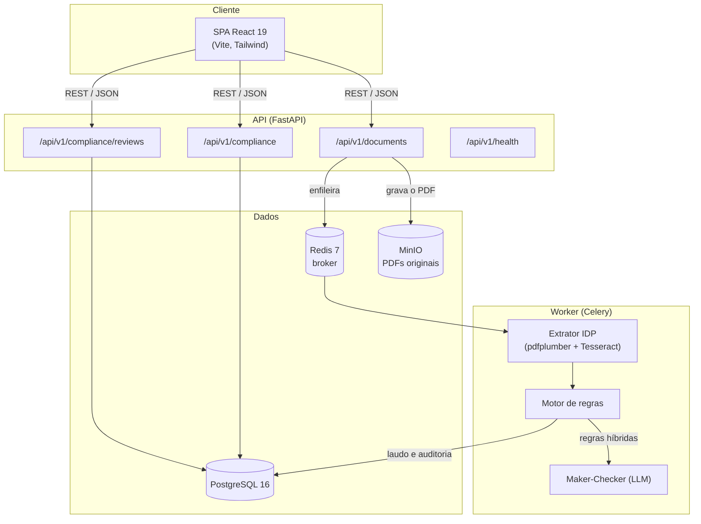

# Visão Geral da Arquitetura

O Conform.IA BNDES é um monorepo modular (ver [ADR-001](adr-001-monorepo-modular.md)) com uma
SPA React, uma API FastAPI e workers Celery. O ciclo HTTP da API fica separado do processamento
pesado (OCR, regras e IA), que roda de forma assíncrona.

---

## 1. Topologia de serviços

| Serviço | Tecnologia | Responsabilidade |
| :-- | :-- | :-- |
| `frontend` | React 19, Vite, Tailwind CSS 4, Axios | Upload, acompanhamento do processamento, laudo e revisão humana |
| `api` | Python 3.11, FastAPI, SQLAlchemy 2, Pydantic 2, Alembic | Contratos REST, autenticação por chave pessoal, persistência e auditoria |
| `worker` | Celery 5, pdfplumber, pytesseract, Poppler | Extração, OCR, motor de regras e Maker-Checker fora do ciclo HTTP |
| `postgres` | PostgreSQL 16 | Documentos, verificações, trilha de auditoria e eventos de revisão |
| `redis` | Redis 7 | Broker e backend de resultados do Celery |
| `minio` | MinIO (API S3) | Armazenamento dos PDFs originais |

A orquestração local e do CI é feita por `infra/docker-compose.yml`.

---

## 2. Fluxo de processamento

1. **Ingestão.** `POST /api/v1/documents/upload` valida o arquivo (extensão, tipo e assinatura
   `%PDF-`), calcula o SHA-256, grava o PDF no MinIO e cria o registro do documento (status
   `PROCESSING` quando enviado à fila).
2. **Fila.** A API enfileira a tarefa no Redis e devolve o `task_id`; o andamento é consultado em
   `GET /api/v1/documents/tasks/{task_id}`.
3. **Extração.** O worker extrai o texto nativo com pdfplumber e recorre ao OCR (Tesseract, idioma
   `por`) nas páginas com menos de 50 caracteres. Ver [Pipeline IDP](../engineering/idp-pipeline.md).
4. **Tipologia.** O parser identifica o tipo do documento (CND federal, CRF do FGTS, CNDT...). Sem
   tipologia identificada, o laudo fica em `MANUAL_REVIEW_REQUIRED`.
5. **Regras.** O [motor de regras](../engineering/rules-engine.md) avalia somente as regras da
   tipologia; as demais ficam `NOT_APPLICABLE`. Regras híbridas passam pelo
   [Maker-Checker](../engineering/maker-checker.md).
6. **Laudo e auditoria.** As verificações substituem o laudo vigente em `compliance_checks`, na
   mesma transação do registro em `audit_logs`, que guarda o histórico de cada avaliação. A
   decisão humana é registrada em `review_events` (somente inserção).

---

## 3. Por que regras e IA ficam separadas

O maior risco de usar IA em conformidade de crédito público é aprovar um documento irregular
por erro do modelo. Por isso a decisão é dividida:

| Aspecto | Motor de regras (determinístico) | Maker-Checker (LLM) |
| :-- | :-- | :-- |
| Usado para | Palavras-chave obrigatórias e impeditivas, validade temporal | Regras híbridas (falência, licença ambiental), após a triagem determinística |
| Pode aprovar? | Sim, se todos os critérios forem atendidos | Somente se o Checker aprovar e a citação existir literalmente no documento |
| Em caso de falha | `NON_COMPLIANT` ou `MANUAL_REVIEW_REQUIRED` | Sempre `MANUAL_REVIEW_REQUIRED` (LLM indisponível, resposta inválida, citação ausente) |

Nenhum caminho de falha produz `COMPLIANT`: ausência de dado ou de avaliação vira revisão humana.

---

## 4. Modelo de dados

| Tabela | Conteúdo |
| :-- | :-- |
| `documents` | Metadados do arquivo, caminho no MinIO, status do processamento, texto e metadados extraídos |
| `compliance_checks` | Resultado por regra: status, confiança, evidência (JSON), achados e tipo de verificador |
| `audit_logs` | Ação, entidade, executor e detalhes, com data e hora |
| `review_events` | Propostas e confirmações da revisão humana, com perfil e justificativa |

O esquema evolui por migrations do Alembic (`backend/alembic/`).

---

## 5. Decisões registradas

| ADR | Decisão |
| :-- | :-- |
| [ADR-001](adr-001-monorepo-modular.md) | Monorepo modular |
| [ADR-002](adr-002-astral-uv-toolchain.md) | Astral uv como gerenciador de pacotes e lockfile único |
| [ADR-003](adr-003-spa-vs-nextjs.md) | SPA React em vez de Next.js |

Novas decisões seguem o [modelo de ADR](adr-template.md).
