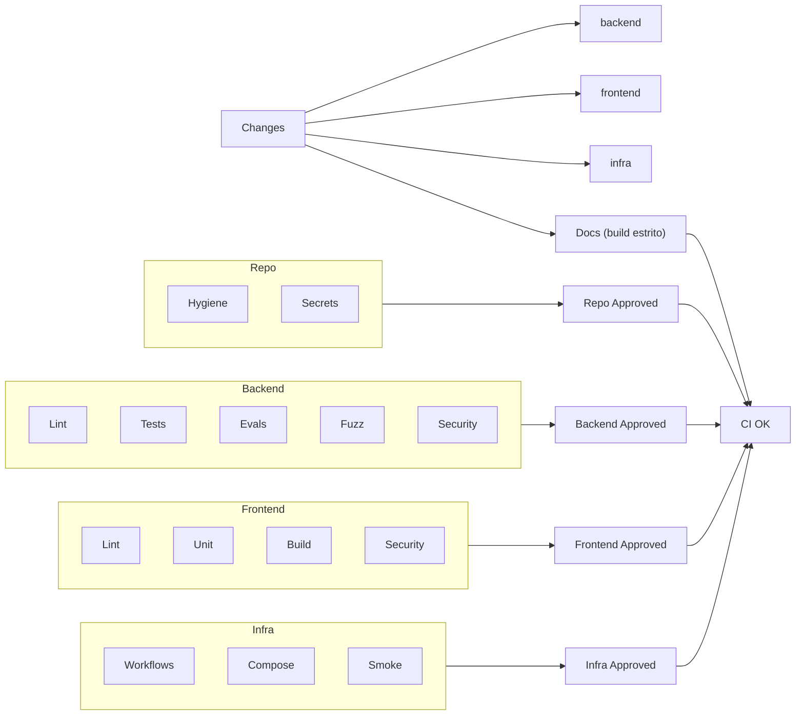

# DevOps: Fluxo de Entrega e Operação

Como o código sai da máquina do desenvolvedor e chega à demonstração, com quais verificações
em cada etapa e como voltar atrás quando algo falha.

!!! info "Resumo"
    `feature/*` → PR para **`dev`** (integração) → PR de promoção para **`main`** →
    release-please abre o PR de versão → merge gera a tag `vX.Y.Z` e o GitHub Release.

---

## 1. Fluxo de branches

| Branch | Papel | Proteção |
| :-- | :-- | :-- |
| `main` | Versão estável e demonstrável; origem das releases | Ruleset `main-protection`: PR com 1 aprovação (descartada a cada novo push; quem fez o último push não aprova), branch atualizada e check **CI OK** verde, sem push forçado nem exclusão. Bypass do time `maintainers` |
| `dev` | Integração contínua do time | Ruleset `dev-protection`: PR obrigatório e check **CI OK** verde, sem push forçado nem exclusão. O time `maintainers` só ignora as regras ao mergear PRs: ninguém apaga `dev` nem faz push direto |
| `feat/*`, `fix/*`, `chore/*`, `docs/*` | Trabalho de uma issue | Abertas a partir de `dev` |

**Regras práticas**

1. Toda mudança começa em uma issue do [Project do MVP](https://github.com/orgs/conformia-bndes/projects/2).
2. O título do PR segue **Conventional Commits** (`feat:`, `fix:`, `docs:`, `sec:`...). O workflow
   `pr-title.yml` valida o título; o release-please usa os tipos para gerar o CHANGELOG.
3. PRs empilhados são permitidos: a base é o PR anterior e muda para `dev` após o merge dele.
4. Dependabot abre PRs em `dev`, com atualizações minor e patch agrupadas.

---

## 2. Pipelines (GitHub Actions)

O `ci.yml` é só o orquestrador. Cada área é um **workflow reutilizável** (`ci-repo.yml`,
`ci-backend.yml`, `ci-frontend.yml`, `ci-infra.yml`) com jobs pequenos que rodam em paralelo, e
cada área tem um gate "… Approved". O job **CI OK** consolida tudo e é o único check obrigatório
nos rulesets: área pulada (sem mudança) aprova; falha ou cancelamento bloqueia o merge.



Nenhuma área espera a outra, então o tempo total é o do job mais lento (hoje, o smoke em Docker
ou o fuzzing, perto de 2 minutos). O filtro por caminho (job `changes`) pula as áreas que o PR não
toca; em push para `main`/`dev`, execução manual e na execução semanal (segunda, 06:00 UTC) tudo
roda.

| Área | Jobs | O que garante |
| :-- | :-- | :-- |
| Repo | Hygiene, Secrets | Hooks de higiene do pre-commit (YAML, JSON, chaves privadas, espaços) e gitleaks no histórico completo |
| Backend | Lint, Tests, Evals, Fuzz, Security | black e flake8; pytest com cobertura; benchmark de regras (0 falsos positivos, relatório como artefato); fuzzing Atheris de 60 s; pip-audit sobre o `uv.lock` |
| Frontend | Lint, Unit, Build, Security | ESLint; Vitest; typecheck e build de produção; `npm audit` |
| Infra | Workflows, Compose, Smoke | actionlint; validação do `docker-compose.yml`; stack completa em Docker Compose com imagens em cache (upload → fila → worker) |
| Docs | Docs | `mkdocs build --strict` com a verificação do site |

Outros workflows:

| Workflow | Gatilho | O que garante |
| :-- | :-- | :-- |
| `pr-title.yml` | abertura e edição de PR | Título do PR em Conventional Commits |
| `codeql.yml` | push, PR e semanal | Análise estática de segurança (Python, TypeScript e os próprios workflows) |
| `scorecard.yml` | push em `main` e semanal | OpenSSF Scorecard: práticas de segurança da cadeia de suprimentos |
| `release-please.yml` | push em `main` | PR de release com versão semântica e CHANGELOG |
| `docs.yml` | push em `main` | Publicação desta documentação no GitHub Pages (artefato, sem branch `gh-pages`) |
| `llm-evals.yml` | manual | Testes do Maker-Checker com LLM real (promptfoo); consome créditos |

**Cadeia de suprimentos.** Todas as actions são fixadas por SHA de commit (com a versão em
comentário), as imagens Docker por digest e o binário do gitleaks por checksum. Cada workflow
declara permissões mínimas (`contents: read` por padrão). O Dependabot atualiza SHAs, digests e
o `uv.lock` em PRs agrupados para `dev`.

**Acrescentar um check.** Crie o job no workflow da área (`ci-<área>.yml`); o gate da área e o
**CI OK** já o consideram. Nenhuma regra de branch precisa ser alterada.

!!! warning "Permissão necessária para o release-please"
    O release-please abre PRs com o `GITHUB_TOKEN`. Em **Settings → Actions → General**, a opção
    *Allow GitHub Actions to create and approve pull requests* precisa estar habilitada (na
    organização e no repositório).

---

## 3. Verificações locais antes do push

```bash
make hooks        # uma vez por clone: instala os hooks pre-commit
make lint         # flake8, black e ESLint
make test         # pytest e Vitest
make eval         # benchmark de regras (0 falsos positivos obrigatório)
make docs-build   # documentação em modo estrito
```

Os hooks rodam black e flake8 com as versões do `uv.lock` (as mesmas do CI), além de gitleaks,
detecção de chaves privadas e validação de YAML/JSON.

---

## 4. Ambientes e configuração

| Ambiente | Como sobe | Observações |
| :-- | :-- | :-- |
| Local | `make up` + `make smoke` | `.env` gerado por `make env` com segredos aleatórios; nada versionado |
| CI | Serviços efêmeros do GitHub Actions | `.env` gerado a cada execução |
| Demonstração | `make up` na máquina de demo, a partir da tag da release | `ENVIRONMENT` diferente de `development`; usuários em `API_USERS` |

!!! danger "Antes da demonstração"
    Em `development` e `test` a API aceita requisições sem chave (exceto a revisão humana).
    No ambiente de demonstração, defina `ENVIRONMENT=production` e cadastre os analistas em
    `API_USERS` (`python backend/scripts/create_api_user.py <user_id> ANALISTA`).

---

## 5. Release e rollback

**Release**

1. Promover `dev` para `main` por PR.
2. O release-please atualiza o PR de release (versão em `pyproject.toml`,
   `backend/pyproject.toml`, `frontend/package.json` e `config.py`, mais o CHANGELOG).
3. Merge do PR de release → tag `vX.Y.Z` e GitHub Release.

**Rollback**

| Situação | Ação |
| :-- | :-- |
| Defeito na aplicação | `git checkout <tag-anterior>` e `make up` no ambiente afetado |
| Migration problemática | `alembic downgrade -1` **somente** em banco descartável ou após backup; no ambiente de demo, restaurar o volume do PostgreSQL |
| Dependência quebrada | Reverter o PR do Dependabot (`git revert -m 1 <merge>`) |

---

## 6. Diagnóstico rápido

| Sintoma | Onde olhar |
| :-- | :-- |
| `make up` não fica saudável | `make ps`; `GET /api/v1/health` mostra qual dependência está `degraded` |
| Upload retorna 503 | Redis ou MinIO indisponível |
| Documento preso em `PROCESSING` | Logs do `worker` (`make logs`); estado em `GET /api/v1/documents/tasks/{task_id}` |
| Revisão humana retorna 401 | Usuário ausente em `API_USERS` ou chave errada |
| CI do PR não rodou | Base do PR precisa ser `main` ou `dev` |
