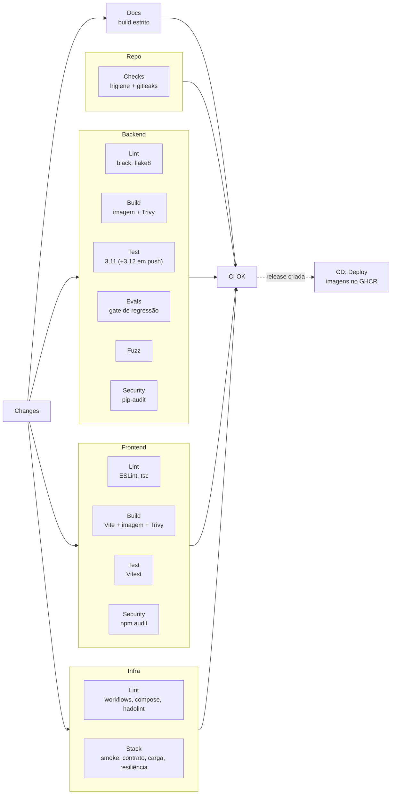

# DevOps: Fluxo de Entrega e Operação

Como o código sai da máquina do desenvolvedor e chega à demonstração, com quais verificações
em cada etapa e como voltar atrás quando algo falha.

!!! info "Resumo"
    `feature/*` → PR para **`dev`** (integração) → PR de promoção para **`main`** →
    release-please abre o PR de versão → merge gera a tag `vX.Y.Z` e o GitHub Release.

---

## 1. Fluxo de branches

| Branch | Papel | Proteção |
| :-- | :-- | :-- |
| `main` | Versão estável e demonstrável; origem das releases | Ruleset `main-protection`: PR com 1 aprovação (descartada a cada novo push; quem fez o último push não aprova), branch atualizada e check **CI OK** verde, sem push forçado nem exclusão. Bypass do time `maintainers` |
| `dev` | Integração contínua do time | Ruleset `dev-protection`: PR obrigatório e check **CI OK** verde, sem push forçado nem exclusão. O time `maintainers` só ignora as regras ao mergear PRs: ninguém apaga `dev` nem faz push direto |
| `feat/*`, `fix/*`, `chore/*`, `docs/*` | Trabalho de uma issue | Abertas a partir de `dev` |

**Regras práticas**

1. Toda mudança começa em uma issue do [Project do MVP](https://github.com/orgs/conformia-bndes/projects/2).
2. O título do PR segue **Conventional Commits** (`feat:`, `fix:`, `docs:`, `sec:`...). O workflow
   `pr-title.yml` valida o título; o release-please usa os tipos para gerar o CHANGELOG.
3. PRs empilhados são permitidos: a base é o PR anterior e muda para `dev` após o merge dele.
4. Dependabot abre PRs em `dev`, com atualizações minor e patch agrupadas.

---

## 2. Pipelines (GitHub Actions)

O `ci.yml` é só o orquestrador. Cada área é um **workflow reutilizável** com estágios explícitos
(`needs`), e as áreas são independentes entre si. Back e front seguem o mesmo roteiro:
**lint, build, test e deploy**; o deploy não roda no CI de PR, só na release (seção abaixo).
Os jobs de uma área **não esperam uns pelos outros**: os testes operam sobre o código-fonte e não
dependem do build da imagem, então encadear só alongaria o caminho crítico. Os estágios são
lógicos (o que cada job verifica), e o tempo total é o do job mais lento.
O job **CI OK** consolida as áreas e é o único check obrigatório nos rulesets: área pulada (sem
mudança) aprova; falha ou cancelamento bloqueia o merge.



Dentro de uma área e entre áreas, tudo roda em paralelo; só o CI OK espera por todas.
**Matriz de Python:** em PR roda só o 3.11 (o do produto); o 3.12 entra em push para `main`/`dev`,
na execução semanal e quando mudam `pyproject.toml`, `uv.lock` ou os workflows.
O filtro por caminho (job `changes`) pula as áreas que o PR não toca; em push para `main`/`dev`,
execução manual e na execução semanal (segunda, 06:00 UTC) tudo roda.

| Área | Estágios | O que garante |
| :-- | :-- | :-- |
| Repo | Checks | Hooks de higiene do pre-commit (YAML, JSON, chaves privadas, espaços) e gitleaks no histórico completo |
| Backend | Lint, Security, Build, Test (matriz), Evals, Fuzz | black e flake8; pip-audit; build da imagem de produção com scan do Trivy; pytest com cobertura em Python 3.11 (produto) e 3.12; benchmark de regras com gate de regressão; fuzzing Atheris de 60 s |
| Frontend | Lint, Security, Build, Test | ESLint e typecheck; npm audit; build do bundle e da imagem de produção (nginx) com scan do Trivy; Vitest |
| Infra | Lint, Stack | estrutura dos workflows, actionlint, hadolint e `docker-compose.yml`; stack completa em Docker Compose com smoke (upload → fila → worker), fuzz de contrato da API, carga e resiliência |
| Docs | Docs | `mkdocs build --strict` com a verificação do site |

### Deploy (CD)

O estágio de deploy é o `cd.yml`. Quando você mergeia o PR de release do release-please, o
`release-please.yml` cria a tag `vX.Y.Z` e chama o CD, que constrói as imagens de produção do
backend e do frontend **a partir da tag** e as publica no GitHub Container Registry:

| Imagem | Tags |
| :-- | :-- |
| `ghcr.io/conformia-bndes/conformia-platform/backend` | `vX.Y.Z`, `latest` |
| `ghcr.io/conformia-bndes/conformia-platform/frontend` | `vX.Y.Z`, `latest` |

As imagens saem com provenance e SBOM anexados e com os rótulos OCI de origem, commit e versão.
O CD também roda manualmente (Actions → CD → Run workflow) com `push` desligado por padrão, o
que só constrói e valida a imagem de uma tag, sem publicar. A chamada vem do `release-please.yml`
porque tags criadas com o `GITHUB_TOKEN` não disparam outros workflows.

### Relatórios de qualidade

Cada área publica artefatos `relatorio-*` (retenção de 30 dias): resultados de testes (JUnit),
cobertura (XML), benchmark de regras, estatísticas do fuzzing e auditorias de dependências. A
cobertura e o gate de regressão dos evals também aparecem no resumo de cada execução do CI.

O `docs.yml` é chamado pelo `ci.yml` (estágio de publicação) em push para `main`, depois do
`CI OK` verde e na mesma execução: o checkout é o do próprio commit e os artefatos são os desta
execução, sem checkout de SHA vindo de outro workflow. Ele baixa esses artefatos e o
hook `docs_hooks/relatorios.py` monta a página [Relatórios de Qualidade](../relatorios/index.md)
do site. Localmente, `make reports` gera os mesmos arquivos em `reports/` e `make docs` os exibe.
A publicação só acontece a partir de push em `main`, nunca de PR.

### Evitar CI quebrado por erro de estrutura

Os métodos de teste, o que cada um já encontrou e os números de desempenho estão em
[Testes e Robustez](../engineering/testing.md).

O job Infra / Lint roda `scripts/check_workflows.py` quando os workflows mudam. Ele confere o
que derruba o CI inteiro sem criar nenhum job: YAML válido com `jobs`, `needs` apontando para
jobs que existem, `uses` locais para arquivos com `workflow_call` e `with` compatível com os
inputs declarados. O actionlint complementa com a análise de expressões e das actions.

Outros workflows:

| Workflow | Gatilho | O que garante |
| :-- | :-- | :-- |
| `pr-title.yml` | abertura e edição de PR | Título do PR em Conventional Commits |
| `codeql.yml` | push, PR e semanal | Análise estática de segurança (Python, TypeScript e os próprios workflows) |
| `scorecard.yml` | push em `main` e semanal | OpenSSF Scorecard: práticas de segurança da cadeia de suprimentos |
| `release-please.yml` | push em `main` | PR de release com versão semântica e CHANGELOG; ao mergear o PR, cria a tag e chama o CD. Para o PR de release também disparar CI e CodeQL, configure um GitHub App (variável `RELEASE_APP_ID` e segredo `RELEASE_APP_PRIVATE_KEY`) ou, alternativamente, o segredo `RELEASE_PLEASE_TOKEN` (PAT); sem eles usa o token padrão, que não dispara outros workflows |
| `cd.yml` | release criada ou manual | Build e publicação das imagens de produção no GHCR (ver Deploy) |
| `docs.yml` | chamado pelo CI em push para `main`, ou manual em `main` | Publicação desta documentação, com os relatórios de qualidade, no GitHub Pages (artefato, sem branch `gh-pages`) |
| `llm-evals.yml` | manual | Testes do Maker-Checker com LLM real (promptfoo); consome créditos |

**Cadeia de suprimentos.** Todas as actions são fixadas por SHA de commit (com a versão em
comentário), as imagens Docker por digest e o binário do gitleaks por checksum. Cada workflow
declara permissões mínimas (`contents: read` por padrão). O Dependabot atualiza SHAs, digests e
o `uv.lock` em PRs agrupados para `dev`.

**Acrescentar um check.** Crie o job no workflow da área (`ci-<área>.yml`); o gate da área e o
**CI OK** já o consideram. Nenhuma regra de branch precisa ser alterada.

!!! warning "Permissão necessária para o release-please"
    O release-please abre PRs com o `GITHUB_TOKEN`. Em **Settings → Actions → General**, a opção
    *Allow GitHub Actions to create and approve pull requests* precisa estar habilitada (na
    organização e no repositório).

---

## 3. Verificações locais antes do push

```bash
make hooks        # uma vez por clone: instala os hooks pre-commit
make lint         # flake8, black e ESLint
make test         # pytest e Vitest
make eval         # benchmark de regras (0 falsos positivos obrigatório)
make docs-build   # documentação em modo estrito
```

Os hooks rodam black e flake8 com as versões do `uv.lock` (as mesmas do CI), além de gitleaks,
detecção de chaves privadas e validação de YAML/JSON.

---

## 4. Ambientes e configuração

| Ambiente | Como sobe | Observações |
| :-- | :-- | :-- |
| Local | `make up` + `make smoke` | `.env` gerado por `make env` com segredos aleatórios; nada versionado |
| CI | Serviços efêmeros do GitHub Actions | `.env` gerado a cada execução |
| Demonstração | `make up` na máquina de demo, a partir da tag da release | `ENVIRONMENT=production`, `DEBUG=False`, `ALLOW_ANONYMOUS_ACCESS=false`; usuários em `API_USERS` |

!!! danger "Antes da demonstração"
    O `.env` gerado por `make env` vem do perfil de desenvolvimento local (`ENVIRONMENT=development`,
    `DEBUG=True`, `ALLOW_ANONYMOUS_ACCESS=true`), que aceita requisições sem chave (exceto a
    revisão humana). No ambiente de demonstração, ajuste esses três valores
    (`ENVIRONMENT=production`, `DEBUG=False`, `ALLOW_ANONYMOUS_ACCESS=false`) e cadastre os
    analistas em `API_USERS` (`python backend/scripts/create_api_user.py <user_id> ANALISTA`).
    Em `production`, a aplicação recusa iniciar com `DEBUG` ou acesso anônimo ativos.

---

## 5. Release e rollback

**Release**

1. Promover `dev` para `main` por PR.
2. O release-please atualiza o PR de release (versão em `pyproject.toml`,
   `backend/pyproject.toml`, `frontend/package.json` e `config.py`, mais o CHANGELOG).
3. Merge do PR de release → tag `vX.Y.Z` e GitHub Release.

**Rollback**

| Situação | Ação |
| :-- | :-- |
| Defeito na aplicação | `git checkout <tag-anterior>` e `make up` no ambiente afetado |
| Migration problemática | `alembic downgrade -1` **somente** em banco descartável ou após backup; no ambiente de demo, restaurar o volume do PostgreSQL |
| Dependência quebrada | Reverter o PR do Dependabot (`git revert -m 1 <merge>`) |

---

## 6. Diagnóstico rápido

| Sintoma | Onde olhar |
| :-- | :-- |
| `make up` não fica saudável | `make ps`; `GET /api/v1/health` mostra qual dependência está `degraded` |
| Upload retorna 503 | Redis ou MinIO indisponível |
| Documento preso em `PROCESSING` | Logs do `worker` (`make logs`); estado em `GET /api/v1/documents/tasks/{task_id}` |
| Revisão humana retorna 401 | Usuário ausente em `API_USERS` ou chave errada |
| CI do PR não rodou | Base do PR precisa ser `main` ou `dev` |
