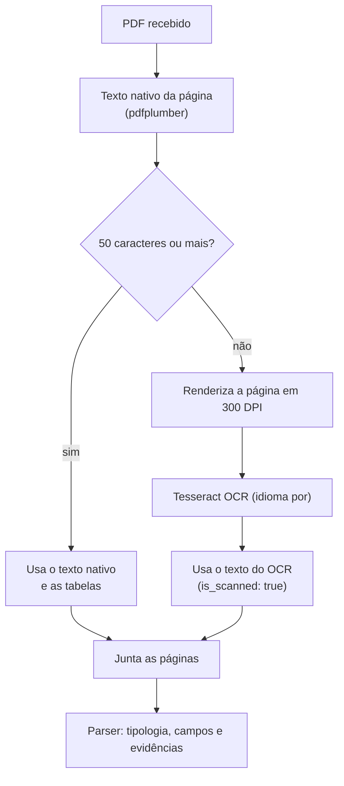

# Pipeline IDP e OCR

O pipeline de Intelligent Document Processing converte o PDF enviado em texto, tabelas e
metadados por página, e identifica a tipologia do documento para o motor de regras.

Implementação: `backend/app/idp/extractor.py` (`DocumentExtractor`) e
`backend/app/idp/parser.py` (tipologia, campos e evidências).

---

## 1. Extração híbrida

1. Cada página é aberta com pdfplumber, que extrai texto e tabelas nativas.
2. Se a página tem menos de 50 caracteres nativos (`min_char_threshold`), é tratada como
   digitalizada: é renderizada em 300 DPI e enviada ao Tesseract com o idioma `por`.
3. As páginas são unidas no `full_text`, separadas por `--- [QUEBRA DE PÁGINA] ---`.
4. O parser identifica a tipologia (`CND_FEDERAL`, `CRF_FGTS`, `CNDT_TRABALHISTA`...) e registra,
   para cada campo, a página e o trecho em que foi encontrado.

O OCR exige `tesseract-ocr` e `tesseract-ocr-por`, já instalados na imagem do backend.

---

## 2. Saída por página

| Campo | Conteúdo |
| :-- | :-- |
| `page_number` | Número da página (a partir de 1) |
| `text`, `char_count` | Texto final da página e seu tamanho |
| `tables` | Tabelas nativas extraídas pelo pdfplumber |
| `is_scanned`, `ocr_attempted` | Se a página foi tratada como digitalizada e se o OCR foi executado |
| `extraction_method` | `native` ou `ocr` |
| `error` | Erro da página, quando houver (`OCR_FAILED` ou `EMPTY_PAGE`) |

Os erros por página também ficam em `metadata["page_errors"]`. A extração estruturada do
documento pode ser consultada em `GET /api/v1/documents/{document_id}/processing`.

---

## 3. Falhas

| Situação | Comportamento |
| :-- | :-- |
| Uma página sem texto (nativo e OCR vazios) ou com OCR falho | A página registra o erro; as demais seguem |
| Nenhuma página legível, PDF corrompido ou protegido por senha | Extração falha e o documento fica com status `EXTRACTION_FAILED` |
| Tipologia não identificada | Nenhuma regra é aplicada e o laudo fica em `MANUAL_REVIEW_REQUIRED` |
| Processamento acima de 10 minutos | O Celery interrompe a tarefa (`task_time_limit = 600`) |

!!! note "Limitações conhecidas"
    Não há pré-processamento de imagem (correção de inclinação, binarização) antes do OCR, e a
    data de validade é reconhecida apenas em formatos `dd/mm/aaaa` próximos a palavras como
    "válida até" ou "validade". Ver os resultados em [Avaliação contínua](harness-evals.md).
