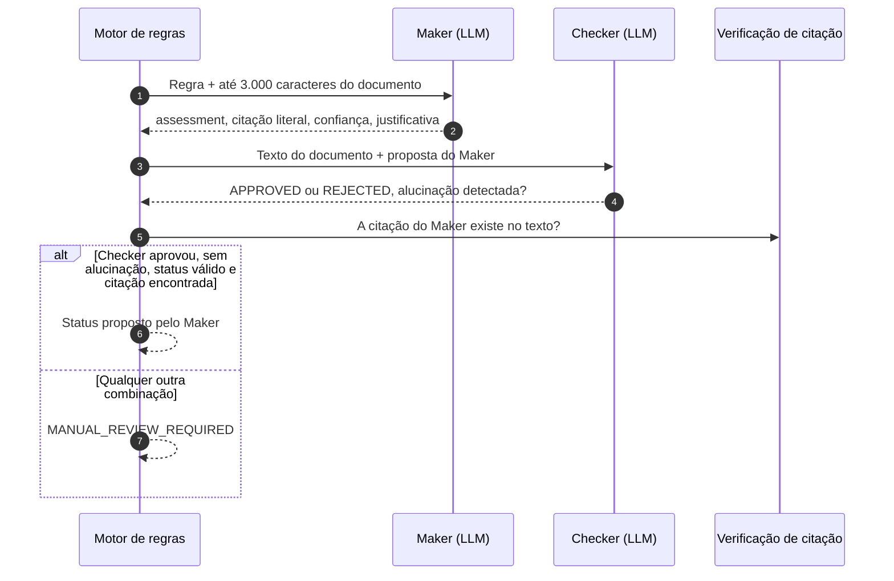

# Maker-Checker e Guardrails de IA

O LLM só participa da decisão nas regras híbridas e sempre sob o padrão **Maker-Checker**: um
modelo propõe, outro audita e uma verificação determinística confirma a evidência. Qualquer
falha nesse ciclo leva à revisão humana, nunca à aprovação.

Implementação: `backend/app/ai/llm_client.py` (`MakerCheckerValidator`).

---

## 1. Ciclo de avaliação

| Papel | Responsabilidade |
| :-- | :-- |
| **Maker** | Propor `COMPLIANT`, `NON_COMPLIANT` ou `MANUAL_REVIEW_REQUIRED` com a citação literal (`extracted_value`) que fundamenta a proposta |
| **Checker** | Receber o texto e a proposta do Maker e avaliar, em chamada separada, se a proposta é sustentada pelo texto e se há alucinação |
| **Verificação de citação** | Confirmar de forma determinística que a citação aparece no documento, ignorando acentos, caixa e espaços |

A confiança final é a média das confianças do Maker e do Checker quando a proposta é aceita, e
zero quando não é.

---

## 2. Comportamento em falhas (fail-closed)

| Situação | Resultado |
| :-- | :-- |
| `OPENAI_API_KEY` ausente ou erro do provedor (`LLMUnavailableError`) | `MANUAL_REVIEW_REQUIRED`, com `error: LLM_UNAVAILABLE` na evidência |
| Resposta do Maker ou do Checker que não é JSON válido | `MANUAL_REVIEW_REQUIRED` |
| Status proposto fora do domínio | `MANUAL_REVIEW_REQUIRED` |
| Checker rejeita ou aponta alucinação | `MANUAL_REVIEW_REQUIRED` |
| Citação vazia ou inexistente no documento | `MANUAL_REVIEW_REQUIRED` |

Configuração: `LLM_MODEL` (padrão `gpt-4o-mini`), `LLM_TEMPERATURE` (padrão `0.0`) e
timeout de 30 segundos por chamada.

---

## 3. Guardrails do produto

1. **Sem validade legível, sem aprovação.** Certidões fiscais e trabalhistas sem data de validade
   identificada vão para `MANUAL_REVIEW_REQUIRED` antes de qualquer etapa de IA.
2. **O LLM não tem ferramentas.** Ele recebe apenas a regra e um trecho do texto, e devolve JSON.
   Somente a camada de serviços grava no banco.
3. **Revisão humana com segregação de funções.** A decisão final sobre um laudo em revisão é
   proposta por um analista e confirmada por outro (quem propõe não pode confirmar), e fica
   registrada em `review_events` (somente inserção).
4. **Regra nova exige caso de teste.** Toda regra entra com casos no benchmark de
   [avaliação contínua](harness-evals.md), e o CI bloqueia falsos positivos.

---

## 4. Harness de desenvolvimento

O mesmo princípio vale para agentes de IA que ajudam a construir o software. As regras ficam
em `AGENTS.md` na raiz do repositório: nada de comandos destrutivos, commits pequenos em
Conventional Commits, validação com testes reais antes de declarar uma tarefa concluída e nenhum
segredo em código, logs ou relatórios. Os hooks do pre-commit e os checks obrigatórios do CI
aplicam essas regras independentemente de quem escreveu o código.
