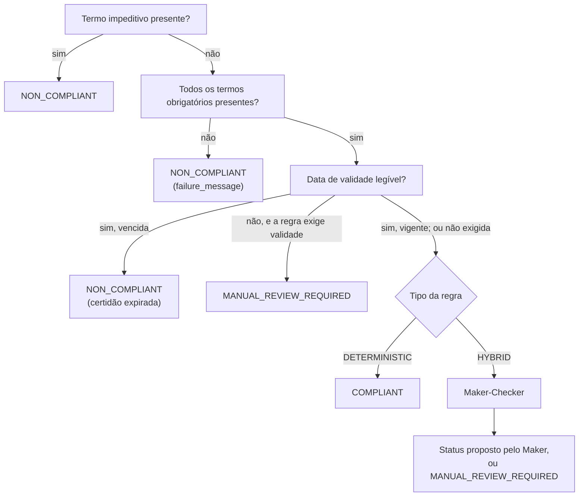

# Motor de Regras

O motor de regras (`backend/app/services/rules_engine.py`, classe `RulesEngine`) avalia o texto
extraído de um documento contra o checklist declarativo do BNDES e produz o laudo de
conformidade. As regras ficam fora do código, em JSON versionado.

---

## 1. Checklist declarativo

| Arquivo | Conteúdo |
| :-- | :-- |
| `rules/schemas/rule_schema.json` | JSON Schema que valida a estrutura de cada regra |
| `rules/schemas/bndes_sample_checklist.json` | Checklist de referência do MVP (6 regras) |

| ID | Código (tipologia) | Categoria | Tipo | Severidade | Validade obrigatória |
| :-- | :-- | :-- | :-- | :-- | :-- |
| RULE-BNDES-001 | `CND_FEDERAL` | FISCAL | DETERMINISTIC | CRITICAL | Sim |
| RULE-BNDES-002 | `CRF_FGTS` | TRABALHISTA | DETERMINISTIC | CRITICAL | Sim |
| RULE-BNDES-003 | `CNDT_TRABALHISTA` | TRABALHISTA | DETERMINISTIC | CRITICAL | Sim |
| RULE-BNDES-004 | `FALENCIA_RECUPERACAO` | JURIDICA | HYBRID | CRITICAL | Não |
| RULE-BNDES-005 | `LICENCA_AMBIENTAL` | AMBIENTAL | HYBRID | HIGH | Não |
| RULE-BNDES-006 | `INTEGRIDADE_CEIS_CNEP` | INTEGRIDADE | DETERMINISTIC | CRITICAL | Não |

Campos de cada regra:

| Campo | Uso |
| :-- | :-- |
| `id`, `code`, `title` | Identificação. O `code` é a tipologia do documento a que a regra se aplica |
| `category`, `severity`, `legal_basis` | Classificação e fundamento normativo exibidos no laudo |
| `type` | `DETERMINISTIC` ou `HYBRID` |
| `required_keywords` | Termos que precisam estar todos presentes |
| `anti_keywords` | Termos impeditivos: a presença de qualquer um reprova a regra |
| `regex_patterns` | Padrões registrados como evidência quando encontrados; não reprovam a regra |
| `requires_validity` | Exige data de validade legível. Ausente, vale `true` para FISCAL e TRABALHISTA |
| `failure_message` | Mensagem do laudo quando os termos obrigatórios não são encontrados |

---

## 2. Seleção das regras por tipologia

O parser IDP identifica a tipologia do documento (por exemplo `CND_FEDERAL`). O motor avalia
**somente as regras cujo `code` corresponde à tipologia**; as demais entram no laudo como
`NOT_APPLICABLE`. Sem esse filtro, uma CND válida seria reprovada por não ser um CRF do FGTS.

Quando a tipologia não é identificada, o serviço chama `RulesEngine.not_evaluable()`: nenhuma
regra é aplicada, todas ficam `NOT_APPLICABLE` e o laudo geral é `MANUAL_REVIEW_REQUIRED`. A
ausência de avaliação nunca equivale a conformidade.

---

## 3. Avaliação de uma regra

O texto é normalizado (sem acentos, em maiúsculas) e as etapas são aplicadas em ordem; a
primeira que decide encerra a avaliação.

**Validade temporal.** A data é procurada em expressões como "válida até", "validade",
"vigência" ou "até", seguidas de `dd/mm/aaaa`. A certidão vale até o fim do dia indicado.

**Regras híbridas.** Depois da triagem determinística, a regra segue para o
[Maker-Checker](maker-checker.md). Se o LLM estiver indisponível, responder fora do formato ou
citar um trecho que não existe no documento, o resultado é `MANUAL_REVIEW_REQUIRED`.

---

## 4. Estados e consolidação do laudo

| Status | Significado |
| :-- | :-- |
| `COMPLIANT` | Todos os critérios da regra foram atendidos |
| `NON_COMPLIANT` | Termo impeditivo, termo obrigatório ausente ou certidão vencida |
| `MANUAL_REVIEW_REQUIRED` | Validade ilegível, tipologia não identificada ou avaliação semântica não confirmada |
| `NOT_APPLICABLE` | A regra não se aplica à tipologia do documento |

A função `summarize_statuses` consolida o laudo **ignorando as regras `NOT_APPLICABLE`**:

1. Qualquer `NON_COMPLIANT` → laudo `NON_COMPLIANT`.
2. Senão, qualquer `MANUAL_REVIEW_REQUIRED` (ou score abaixo de 1) → `MANUAL_REVIEW_REQUIRED`.
3. Senão → `COMPLIANT`.

O score é a fração de regras aplicáveis em `COMPLIANT`. Sem nenhuma regra aplicável, o score é
0 e o laudo vai para revisão manual.

---

## 5. Como adicionar ou alterar uma regra

1. Editar `rules/schemas/bndes_sample_checklist.json` respeitando `rule_schema.json`.
2. Incluir casos no benchmark (`evals/datasets/`) que provem a aprovação e a reprovação da regra.
3. Rodar `make eval`: o CI bloqueia qualquer falso positivo ou acurácia abaixo de 90%.
4. Abrir o PR com o resultado do benchmark. Ver [Avaliação contínua](harness-evals.md).
