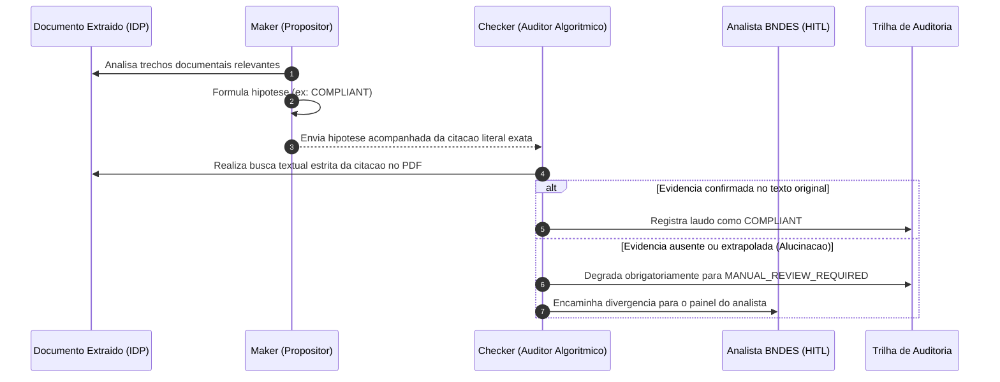

# Harness Engineering e Operação de Agentes

Este documento formaliza os princípios de **Harness Engineering** aplicados no desenvolvimento e na operação da plataforma Conform.IA BNDES, alinhando as diretrizes institucionais do projeto ao padrão agent-first estabelecido em `.agents/AGENTS.md`.

---

## 1. O Conceito de Harness Engineering

Harness Engineering é a disciplina de engenharia que envolve modelos e agentes de IA com **condições estritas de contorno, contexto rigorosamente delimitado, ferramentas de mínimo privilégio, estado persistente e mecanismos de verificação automática**.

A confiabilidade de um sistema de decisão crítica não depende do texto isolado de um prompt, mas sim da solidez do _harness_ que governa sua execução.

---

## 2. As Duas Dimensões de Harness na Plataforma

```mermaid
flowchart TD
    subgraph HarnessDev["1. Harness do Desenvolvimento (Engenharia de Software)"]
        AgenteDev["Agente Autônomo de IA"]
        ContextoGit["Contexto de Monorepo (.agents, docs)"]
        FerramentasLocais["Ferramentas Estritas (pytest, uv, git)"]
        QualityGate["Quality Gate (Black, Flake8, Evals)"]
        AgenteDev --> ContextoGit --> FerramentasLocais --> QualityGate
    end

    subgraph HarnessProd["2. Harness do Produto (Orquestracao Documental BNDES)"]
        PDF["Documento PDF Ingerido"]
        ExtratorIDP["Pipeline IDP (Texto + OCR)"]
        Maker["Propositor Maker (LLM)"]
        Checker["Auditor Checker (Determinístico)"]
        HITL["Revisão Humana (Analista BNDES)"]
        PDF --> ExtratorIDP --> Maker --> Checker --> HITL
    end
```

### 2.1 Harness do Desenvolvimento (Agent-First Engineering)

Controla como agentes autônomos auxiliam na construção do software. O agente não possui permissão para executar comandos destrutivos (`--force`, `drop table`, `rm -rf`), opera sob convenções estritas (Conventional Commits, ausência de emojis) e deve validar cada incremento com testes reais antes de qualquer conclusão.

### 2.2 Harness do Produto (In-App Document Orchestration)

Controla a execução interna da IA durante a análise documental. O modelo recebe apenas trechos delimitados de texto, esquemas Pydantic rígidos e instruções declarativas.

---

## 3. O Padrão Maker-Checker (Quatro Olhos Algoritmico)

Para erradicar qualquer possibilidade de aprovação indevida por alucinação semântica, a verificação de cláusulas e documentos adota o padrão **Maker-Checker**:

---

## 4. Guardrails e Limites Operacionais Invioláveis

Conforme definido no estatuto de operação em `.agents/AGENTS.md`, vigoram os seguintes limites absolutos:

1. **Nunca Assumir Validade por Ausência de Dados**:
   - Se uma certidão não contem a data de validade de forma legível, ela deve ser marcada como `MANUAL_REVIEW_REQUIRED`, nunca como `COMPLIANT`.
2. **Mínimo Privilegio de Ferramentas**:
   - As ferramentas acessíveis aos agentes de extração são estritamente de leitura sobre o documento. Apenas a camada transacional de serviços grava no banco.
3. **Proteção de PII e Sigilo Bancário**:
   - Logs e traces OpenTelemetry são higienizados para não expor CPF ou dados bancários de socios proponentes.
4. **Validação Estrita de Regras**:
   - Nenhuma regra pode ser adicionada a `rules/schemas/` sem que haja um caso de teste correspondente no benchmark de `evals/eval_pipeline.py`.
