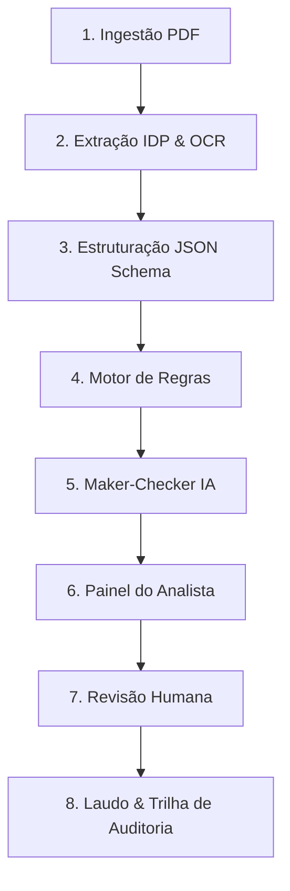

# Planejamento Inicial de Projeto — Conform.IA BNDES

!!! warning "Documento histórico"
    Planejamento elaborado no início do projeto, mantido como registro. O escopo, as datas e o
    estado atual estão no [Plano de Entrega](DELIVERY_PLAN_2026_12_05.md), no
    [Backlog](IMPLEMENTATION_BACKLOG.md) e no [Relatório de Validação](VALIDATION_REPORT.md).
    A data de entrega adotada é **05/12/2026**.

**Plataforma de Intelligent Document Processing para Verificação Automatizada de Conformidade**
_Documento Inicial de Direcionamento Técnico_

---

## Informações Gerais e Parâmetros de Projeto

| Parâmetro                           | Definição Inicial                                                                            |
| :---------------------------------- | :------------------------------------------------------------------------------------------- |
| **Desafio de Referência**           | Consulta Pública BNDES nº 01/2025 — Checklist de Conformidade                                |
| **Data de Encerramento do Projeto** | 07/12/2026                                                                                   |
| **Modalidade Proposta**             | SaaS, com arquitetura preparada para hospedagem e tratamento de dados em território nacional |
| **Público-Alvo Principal**          | Analistas de crédito, revisores e administradores envolvidos na verificação de conformidade  |
| **Status do Documento**             | Versão inicial de planejamento — sujeita a refinamento após validação dos requisitos e dados |
| **Localidade e Data**               | Brasília — DF, setembro de 2026                                                              |

---

## 1. Resumo Executivo

O presente documento estabelece o planejamento inicial da solução **Conform.IA BNDES**, concebida para responder ao desafio apresentado pelo Banco Nacional de Desenvolvimento Econômico e Social (BNDES) na Consulta Pública nº 01/2025. O desafio consiste em interpretar automaticamente documentos não estruturados e aplicar regras de negócio para verificar conformidade, confrontando informações extraídas dos documentos com normativos internos, bases de dados e sistemas de tecnologia da informação.

A proposta parte de uma arquitetura de Intelligent Document Processing (IDP), combinando ingestão documental, OCR e extração estruturada, mecanismos de interpretação assistidos por IA, motor de regras parametrizável, integração com fontes externas, interface de revisão humana, rastreabilidade e geração de relatórios auditáveis.

O objetivo do projeto é construir um MVP tecnicamente demonstrável, priorizando um fluxo ponta a ponta: receber um documento, extrair informações, executar pontos de um checklist, apresentar evidências e resultados, registrar a trilha de auditoria e permitir revisão humana. A solução é concebida desde o início com segurança, governança, observabilidade e capacidade de avaliação de acurácia.

### 1.1 Objetivos do Planejamento

- Traduzir o problema do BNDES em requisitos de produto e requisitos técnicos verificáveis.
- Definir uma arquitetura inicial compatível com IDP, IA, regras de negócio, integração e auditoria.
- Estabelecer um MVP com escopo controlado e critérios objetivos de aceite.
- Organizar a execução em sprints estruturadas até 07/12/2026.
- Incorporar práticas de Harness Engineering ao processo de desenvolvimento assistido por agentes de IA.
- Criar uma base solida para evolução futura para múltiplos tipos de documentos, checklists, integrações e modelos de IA.

### 1.2 Premissa de Escopo

O edital disponibilizado não fornece amostras reais de documentos confidenciais do BNDES, contratos de APIs internas ou o conjunto completo de regras de negócio normativas. Assim, o MVP utiliza documentos e dados sintéticos autorizados, mantendo interfaces de integração desacopladas por meio de adaptadores e contratos tipados para posterior conexão a fontes reais de produção.

---

## 2. Edital de Referência e Entendimento do Desafio

A referência primária deste planejamento e a **CONSULTA PUBLICA BNDES No 01/2025**, cujo objeto e verificar a adequação de soluções voltadas a interpretação automatizada de documentos não estruturados e a aplicação de regras de negócio para verificação de conformidade. O edital explicita que a conferência deve relacionar informações dos documentos a normativos internos e dados de bases e sistemas de TI, buscando eficiência, rastreabilidade e segurança na tomada de decisão institucional.

- **Documento de Referência**: Consulta Pública BNDES no 01/2025 (Errata de 17/09/2025).
- **Plataforma Indicada**: WorldLabs — Consulta BNDES Checklist de Conformidade.

### 2.1 Contexto Apresentado pelo BNDES

Segundo o edital, o BNDES atua em operações de concessão de crédito, investimento e desinvestimento, ofertas publicas, seleção e contratação de fundos FIP/FIDC, alterações de condições financeiras, renegociações de crédito e estruturação de projetos. As verificações de conformidade são realizadas por meio de checklists compostos por critérios definidos em normativos internos e aplicados principalmente a documentos em formato PDF.

O problema operacional e especialmente crítico porque a verificação manual exige esforço intensivo, consultas a múltiplos sistemas e fontes de informação heterogeneas, acarretando riscos de inconsistências, divergências interpretativas e deficiências na rastreabilidade histórica. O edital aponta como direção desejada a automação de etapas criticas, comparação com fontes estruturadas e não estruturadas, orientação contextual, tratamento de exceções e geração de relatórios auditáveis.

### 2.2 Necessidade de Negócio Traduzida para o Projeto

| Necessidade do BNDES                        | Resposta Proposta no Conform.IA BNDES                                                                |
| :------------------------------------------ | :--------------------------------------------------------------------------------------------------- |
| **Interpretar documentos não estruturados** | Pipeline IDP híbrido com análise vetorial nativa, OCR Tesseract, segmentação e normalização.         |
| **Extrair informações estruturadas**        | Esquemas de dados declarativos versionados em JSON Schema, Pydantic e persistência relacional.       |
| **Aplicar critérios de checklist**          | Motor de regras parametrizável e determinístico com regras auditáveis e versionadas.                 |
| **Comparar com bases e sistemas**           | Camada de conectores e adaptadores para APIs REST, bancos relacionais e arquivos externos.           |
| **Orientar o analista de crédito**          | Painel operacional com evidências literais destacadas, explicabilidade e referências legais.         |
| **Tratar inconsistências e exceções**       | Estados formais (`COMPLIANT`, `NON_COMPLIANT`, `MANUAL_REVIEW_REQUIRED`) e fluxo de revisão humana.  |
| **Garantir rastreabilidade integral**       | Trilha de auditoria append-only imutável, versionamento de regras e histórico temporal de análises.  |
| **Controlar performance e acurácia**        | Pipeline de Harness Evals, métricas técnicas e benchmark de regressão continuo.                      |
| **Operar em modelo SaaS**                   | Arquitetura conteinerizada em Docker Compose, multi-tenant e preparada para nuvem nacional.          |
| **LGPD e governança publica**               | Controle de acesso baseado em papeis (RBAC), criptografia em repouso e trânsito, minimização de PII. |

---

## 3. Problemática a Ser Enfrentada

### 3.1 Problema Central

Transformar um processo predominantemente manual, fragmentado e moroso de conferência de conformidade em um fluxo assistido por software de alta confiabilidade, capaz de interpretar documentos, recuperar evidências factuais, aplicar regras de negócio e apresentar resultados verificáveis sem retirar do analista humano a prerrogativa final de decisão sobre casos complexos ou excepcionais.

### 3.2 Principais Dores Operacionais

- Grande volume e heterogeneidade de documentos apresentados pelos proponentes.
- Informações distribuidas em texto corrido, tabelas complexas, carimbos e imagens digitalizadas.
- Necessidade de confrontar informações do documento com certidões e bases governamentais externas (Receita Federal, Caixa/FGTS, TST, Juntas Comerciais).
- Aplicação manual e repetitiva de dezenas de itens de checklists normativos.
- Risco de erro humano, fadiga operacional e divergência interpretativa entre analistas.
- Elevado tempo médio de tramitação dos processos de crédito e investimento.
- Dificuldade de reconstruir e comprovar perante órgãos de controle (TCU, CGU) os fundamentos de uma aprovação pretérita.
- Necessidade de registrar exceções justificadas sem suprimir o histórico da não conformidade original.

### 3.3 Problema de Engenharia de IA

A utilização de Inteligência Artificial em processos que envolvem recursos públicos federais não pode se apoiar em chamadas simples e opacas a modelos de linguagem (chatbots generalistas). O sistema precisa restringir o contexto de operação, delimitar ferramentas, exigir citação literal exata de evidências, submeter a extração a validação por esquemas formais e aplicar regras determinísticas sobre os dados extraídos. Modelos de IA atuam sob o padrão **Maker-Checker**, no qual hipóteses de conformidade são auditadas por um verificador algorítmico independente antes de qualquer consolidação.

### 3.4 Análise de Riscos e Mitigação

| Risco Identificado                                  | Impacto    | Estratégia de Mitigação no Projeto                                                                            |
| :-------------------------------------------------- | :--------- | :------------------------------------------------------------------------------------------------------------ |
| **Alucinação ou extração incorreta de dados**       | Alto       | Citação literal compulsória de evidência, validação Pydantic, padrão Maker-Checker e Human-in-the-Loop.       |
| **Documentos digitalizados com OCR degradado**      | Medio/Alto | Pre-processamento de imagem, binarização, OCR Tesseract calibrado para português e índice de confiança.       |
| **Regra de negócio ou editalicia ambigua**          | Alto       | Esquemas de regras versionados em JSON, suite de testes unitários de regressão e aprovação técnica.           |
| **Exposição inadvertida de dados sensíveis (LGPD)** | Muito Alto | Uso estrito de dados sintéticos no ambiente de desenvolvimento, mascaramento de PII e políticas de retenção.  |
| **Dependência de fornecedor específico de LLM**     | Médio      | Camada de abstração de provedores de IA (`LLMClient`), suportando modelos proprietários e locais open-source. |
| **Indisponibilidade de APIs externas no MVP**       | Médio      | Camada de mocks desacoplada com contratos de interface rigidos compatíveis com futuras integrações reais.     |
| **Opacidade e dificuldade de auditoria de laudos**  | Alto       | Persistência de laudos com snapshot imutável da regra aplicada, versão do modelo e evidência documental.      |

---

## 4. Nome e Identidade Visual

### 4.1 Denominação

**Conform.IA BNDES**: Junção conceitual de "Conformidade" e "Inteligência Artificial", expressando objetividade, sobriedade institucional e foco na missão de auditoria documental.

### 4.2 Conceito e Diretrizes de Design

| Elemento                   | Diretriz Visual                                                                                                                                                                                                             |
| :------------------------- | :-------------------------------------------------------------------------------------------------------------------------------------------------------------------------------------------------------------------------- |
| **Simbolo**                | Prisma documental integrado a elemento de checagem precisa (documento + extração + conformidade).                                                                                                                           |
| **Paleta de Cores**        | Azul institucional profundo (`#0f172a`, `#1e293b`) para solidez e autoridade; azul tecnologico (`#2563eb`, `#38bdf8`) para inovação; neutros técnicos (`#f8fafc`, `#64748b`) para dashboards de alta densidade informativa. |
| **Tipografia**             | Sans-serif contemporanea e limpa (Inter / system fonts), priorizando escaneabilidade visual em tabelas e laudos.                                                                                                            |
| **Sinalização de Estados** | Diferenciação categorica entre `COMPLIANT` (verde corporativo), `NON_COMPLIANT` (vermelho) e `MANUAL_REVIEW_REQUIRED` (ambar), sempre combinando texto, tag e icone para garantia de acessibilidade.                        |
| **Tom e Linguagem**        | Estritamente técnico, formal, sobrio e factual. Proibição absoluta de metaforas ludicas ou emojis.                                                                                                                          |

---

## 5. Solução Proposta — Visão de Produto

O Conform.IA BNDES e estruturado como uma plataforma web de alta produtividade voltada a analistas e gestores de conformidade documental.



### 5.1 Jornada do Usuário

1. **Autenticação**: O analista acessa a plataforma com credenciais autenticadas e perfil de acesso definido.
2. **Seleção de Operação**: Vincula a análise a uma operação de crédito ou proponente específico.
3. **Ingestão Documental**: Upload de arquivos PDF ou recuperação via conectores de armazenamento.
4. **Pre-processamento e IDP**: Extração automática de texto nativo com chaveamento para OCR em páginas digitalizadas.
5. **Estruturação de Entidades**: Reconhecimento de CNPJ, razões sociais, datas de emissão, datas de validade e certidões.
6. **Seleção do Checklist**: O sistema carrega a versão normativa vigente aplicável a operação.
7. **Execução Determinística**: Verificações matemáticas, temporais e lexicais executadas pelo motor de regras.
8. **Análise Assistida por IA**: Avaliação semântica de cláusulas jurídicas e apuração de controversias via Maker-Checker.
9. **Classificação dos Itens**: Cada critério e classificado como Conforme, Não Conforme ou Revisão Manual Obrigatória.
10. **Apresentação de Evidências**: O analista visualiza o documento confrontado diretamente com o trecho probatório.
11. **Intervenção Humana (HITL)**: Analista confirma laudo, insere parecer justificativo ou sinaliza exceção autorizada.
12. **Consolidação e Auditoria**: Gravação do laudo definitivo na trilha de auditoria imutável e emissão de relatório.

### 5.2 Requisitos Funcionais Prioritários

| ID       | Requisito Funcional                                                                  | Prioridade  | Status no Repositório  |
| :------- | :----------------------------------------------------------------------------------- | :---------- | :--------------------- |
| **RF01** | Permitir autenticação segura e perfis de usuário (Admin, Analista, Auditor).         | Alta        | Planejado (Sprint 7)   |
| **RF02** | Upload, armazenamento em MinIO S3 e catalogação de documentos PDF.                   | Alta        | Implementado           |
| **RF03** | Pipeline IDP com extração vetorial (pdfplumber) e fallback OCR (Tesseract).          | Alta        | Implementado           |
| **RF04** | Interpretação estruturada de entidades cadastrais e tabelas.                         | Alta        | Implementado           |
| **RF05** | Suporte a checklists parametrizáveis e versionados via JSON Schema.                  | Alta        | Implementado           |
| **RF06** | Execução de motor de regras determinístico com validação temporal de certidões.      | Alta        | Implementado           |
| **RF07** | Verificação semântica assistida por IA sob padrão Maker-Checker.                     | Alta        | Implementado           |
| **RF08** | Exibição de evidências literais e justificativas técnicas por critério.              | Alta        | Implementado           |
| **RF09** | Interface para revisão humana, contestação e tratamento formal de exceções.          | Alta        | Implementado           |
| **RF10** | Registro cronológico e imutável em trilha de auditoria (`audit_logs`).               | Alta        | Implementado           |
| **RF11** | Geração de relatório consolidado de conformidade exportável.                         | Media       | Planejado (Sprint 6/8) |
| **RF12** | Dashboard com métricas de acurácia, tempo de processamento e distribuição de status. | Media       | Implementado           |
| **RF13** | Integração com fontes externas e governamentais via camada de conectores.            | Media       | Planejado (Sprint 7)   |
| **RF14** | Sistema de alertas operacionais e notificação de certidões vencidas.                 | Baixa/Media | Backlog                |
| **RF15** | Agendamento periodico e reprocessamento em lote de certidões recorrentes.            | Baixa       | Backlog                |

### 5.3 Requisitos Não Funcionais

- **Segurança**: Autenticação centralizada, autorização baseada em papeis (RBAC), segredos isolados em variáveis de ambiente.
- **Rastreabilidade e Imutabilidade**: Toda decisão registra hash documental, versão de regra e identificador de sessão.
- **Auditabilidade**: Laudos associam a citação exata da página e coordenada a cada conclusão técnica.
- **Disponibilidade e Desempenho**: Processamento documental desacoplado em background workers via Celery e Redis.
- **Escalabilidade Horizontal**: Containers stateless tanto na camada web (FastAPI) quanto nos workers de extração.
- **Manutenibilidade**: Monorepo modular, contratos fortemente tipados (Pydantic / TypeScript) e isolamento de dependências.
- **Observabilidade**: Logs estruturados, traces de execução e métricas de avaliação continua.
- **Privacidade e LGPD**: Minimização de dados, ausência de logs com credenciais ou CPF e preparo para destruição segura.
- **Testabilidade**: Suite automatizada de testes unitários, testes de integração e benchmark de regressão continuo.

---

## 6. Arquitetura de Software e Engenharia de Solução

### 6.1 Visão Arquitetural Lógica

A solução adota uma arquitetura em camadas orientada a serviços conteinerizados:

```text
[Frontend SPA (React 18 / Tailwind / Nginx)]
                     |
                     v (HTTP REST / JSON)
[API Gateway & Aplicacao Core (FastAPI / Uvicorn)]
    |                 |                   |
    | (Metadados)     | (Fila Celery)     | (Binarios S3)
    v                 v                   v
[PostgreSQL 16]    [Redis 7]          [MinIO S3]
                      |
                      v
          [Celery Background Workers]
          ├── Extracao IDP (pdfplumber)
          ├── OCR Fallback (Tesseract)
          ├── Motor de Regras Normativas
          └── Orquestrador Maker-Checker (LLM)
```

### 6.2 Matriz de Tecnologias Adotadas

| Camada / Componente          | Tecnologia Adotada                      | Justificativa de Engenharia                                                                                                                   |
| :--------------------------- | :-------------------------------------- | :-------------------------------------------------------------------------------------------------------------------------------------------- |
| **Frontend**                 | React 18 + Vite + TypeScript + Tailwind | Compilação estática ultrarrapida, zero overhead de servidor Node em produção, tipagem estrita e rica experiência operacional para o analista. |
| **Backend API**              | Python 3.11/3.13 + FastAPI + Uvicorn    | Alto desempenho assíncrono (ASGI), integração nativa com bibliotecas de processamento de documentos e validação automática com Pydantic v2.   |
| **Gerenciador de Pacotes**   | Astral `uv`                             | Resolução determinística em milissegundos, workspace monorepo unificado e integração otimizada em containers Docker.                          |
| **Banco Relacional**         | PostgreSQL 16 Alpine                    | Persistência transacional robusta, suporte a integridade referencial, consultas analiticas e histórico de auditoria.                          |
| **Fila e Cache**             | Redis 7 Alpine                          | Fila de mensagens em memória de baixíssima latência para despacho assíncrono de tarefas pesadas.                                              |
| **Processamento Assíncrono** | Celery 5                                | Isolamento do processamento intensivo de OCR e IA do ciclo de vida das requisições HTTP da API.                                               |
| **Armazenamento de Objetos** | MinIO S3 Compatible                     | Compatibilidade estrita com a API AWS S3, permitindo execução local e migração transparente para nuvens publicas brasileiras.                 |
| **Pipeline OCR**             | Tesseract OCR 5 + Poppler Utils         | Solução robusta, auditável e de execução local com suporte consolidado ao português brasileiro (`por`).                                       |
| **Motor de Regras**          | Motor Híbrido Python + JSON Schema      | Regras declarativas, desacopladas do código-fonte da aplicação, fáceis de versionar e auditar.                                                |
| **Padrão Maker-Checker**     | `LLMClient` Abstraido                   | Propositor formula hipótese; auditor algorítmico valida a existência textual exata antes da aprovação.                                        |
| **Conteinerização**          | Docker Engine + Docker Compose          | Isolamento completo de dependências de sistema (Poppler, Tesseract) e portabilidade multiambiente.                                            |
| **Integração Continua**      | GitHub Actions                          | Workflows com path-filtering inteligente, validação de linters, cobertura de testes e scans de segredos.                                      |

### 6.3 Separação Rigorosa entre Regras de Negócio e Modelos de IA

Regras normativas e critérios determinísticos (prazos de validade de certidões, regularidade fiscal perante a Fazenda Nacional, situação cadastral do CNPJ) são avaliados de forma explicita por lógica booleana e expressões regulares auditáveis.

Modelos de linguagem (LLMs) são empregados exclusivamente onde a análise requer interpretação semântica ou compreensão contextual não estruturada. Essa segregação impede que alterações de prompts possam desestabilizar regras criticas de conformidade financeira ou mascarar certidões invalidas.

---

## 7. Matriz de Aderência ao Edital BNDES

| Item Edital      | Expectativa da Consulta Pública             | Implementação no Conform.IA BNDES                                                                 |
| :--------------- | :------------------------------------------ | :------------------------------------------------------------------------------------------------ |
| **II - III**     | Leitura de documentos, variações e OCR      | Pipeline IDP com extração nativa e OCR Tesseract automático em páginas sem camada de texto.       |
| **IV**           | Extração de informações estruturadas        | Esquemas formais em JSON Schema e entidades estruturadas validadas por Pydantic.                  |
| **V**            | Alteração e inclusão de regras pelo usuário | Checklist declarativo parametrizável em `rules/schemas/bndes_sample_checklist.json`.              |
| **VI**           | Explicabilidade e reprodutibilidade         | Gravação de evidências textuais, índices de confiança e laudos com rastreabilidade total.         |
| **VII**          | Perfis de acesso e auditoria                | Trilha de auditoria append-only em `audit_logs` e preparo para perfis de acesso RBAC.             |
| **VIII**         | Visualização de status operacional          | Dashboard operacional com visualização por documento, critério, status e métricas.                |
| **IX**           | Metadados e regras extraidas                | Extração de metadados temporais, número de controle e órgão emissor.                              |
| **X - XI**       | Integração com bases e sistemas             | Camada de conectores com suporte a adaptadores de APIs governamentais e bases corporativas.       |
| **XII - XIII**   | Alertas e agendamento                       | Arquitetura preparada com Celery Beat para execução periodica de rotinas de checagem.             |
| **XIV**          | Logs detalhados de operação                 | Registro cronológico com timestamp UTC, identificador de ação e autor da decisão.                 |
| **XV - XVI**     | Orientação contextual e normativos          | Interface do analista vincula diretamente a base normativa que fundamenta a exigência.            |
| **XVII**         | Revisão detalhada por documento             | Tela de análise com confrontação de evidências e suporte a parecer humano de exceção.             |
| **XVIII - XIX**  | Histórico e análise de desempenho           | Armazenamento de laudos históricos e métricas de recall e acurácia consolidada.                   |
| **XXII - XXIII** | Nuvem e soberania territorial               | Arquitetura conteinerizada em padrão aberto, pronta para operação em data centers nacionais.      |
| **XXIV**         | Conformidade com a LGPD                     | Minimização de dados, ausência de PII em traces/logs e criptografia de credenciais.               |
| **XXV**          | Medição formal de acurácia                  | Suite automatizada de Harness Evals com tolerância zero a falsos positivos em certidões criticas. |

---

## 8. Segurança, LGPD, Governança e Auditoria

### 8.1 Princípios de Governança Pública

- **Security by Design e Privacy by Design**: Práticas de segurança incorporadas desde a primeira linha de código.
- **Minimização de Dados**: O sistema processa estritamente os campos necessários a comprovação de regularidade editalicia.
- **Criptografia**: Comunicação via TLS em trânsito e dados em repouso protegidos no PostgreSQL e MinIO.
- **Gestão de Credenciais**: Nenhuma credencial ou segredo e commitado no repositório; todas as configurações são injetadas via `.env` inspecionado por ferramentas SAST e Gitleaks.

### 8.2 Auditoria Integral da Decisão de Conformidade

Toda análise consolidada armazena um snapshot contendo:

- Hash criptografico (SHA-256) do documento original analisado.
- Versão exata do checklist e das regras normativas aplicadas.
- Citação textual literal que serviu como evidência da conclusão.
- Timestamp UTC da avaliação e identificador do agente ou usuário executor.
- Parecer formal do analista em casos de intervenção ou exceção autorizada.

---

## 9. Estratégia de IA, Avaliação e Controle de Performance

### 9.1 Avaliação Continua (Harness Evals)

A confiabilidade da solução e atestada por meio de um pipeline determinístico de avaliação continua localizado em `evals/eval_pipeline.py`. Nenhuma alteração em prompts ou regras e promovida a produção sem a execução com sucesso da suite de benchmarks.

### 9.2 Métricas de Avaliação Adotadas

| Métrica                           | Finalidade no Projeto                                                  | Meta de Desempenho          |
| :-------------------------------- | :--------------------------------------------------------------------- | :-------------------------- |
| **Falsos Positivos em Certidões** | Medir certidões irregulares indevidamente classificadas como regulares | **0.00% (Tolerância Zero)** |
| **Acurácia Geral do Checklist**   | Concordância de classificação com o ground truth de referência         | >= 95.00%                   |
| **Recall de Extração**            | Proporção de campos obrigatórios recuperados com exatidão              | >= 98.00%                   |
| **Character Error Rate (CER)**    | Qualidade da transcrição do OCR em páginas digitalizadas               | <= 2.50%                    |
| **Tempo Médio por Documento**     | Duração do ciclo de ingestão, OCR e avaliação automática               | < 5 segundos por página     |
| **Taxa de Revisão Humana (HITL)** | Volume de casos encaminhados para análise humana obrigatória           | Monitorada continuamente    |

---

## 10. Planejamento de Sprints até 07/12/2026

O cronograma do projeto e organizado em 8 sprints sequenciais com objetivos mensuráveis e critérios objetivos de entrega:

| Sprint       | Período       | Foco Estratégico            | Objetivos Principais                                                                                                              | Entrega Consolidada                                                   |
| :----------- | :------------ | :-------------------------- | :-------------------------------------------------------------------------------------------------------------------------------- | :-------------------------------------------------------------------- |
| **Sprint 1** | 15/09 – 25/09 | Fundação e Descoberta       | Estrutura de monorepo, Docker Compose oficial, governança sem emojis, documentação inicial, toolchain Astral uv e baseline de CI. | Ambiente reproduzível, monorepo estruturado e CI aprovado.            |
| **Sprint 2** | 26/09 – 06/10 | Ingestão Documental         | Upload de documentos, integração MinIO S3, despacho assíncrono via Celery e pipeline de extração vetorial/OCR Tesseract.          | Documentos ingeridos, armazenados e convertidos em texto e metadados. |
| **Sprint 3** | 07/10 – 17/10 | Extração Estruturada        | Normalização de entidades cadastrais (CNPJ, datas), tabelas e citações de evidências em esquemas JSON Schema e Pydantic.          | JSON estruturado de dados documentais com índices de confiança.       |
| **Sprint 4** | 18/10 – 31/10 | Checklist e Regras          | Motor de regras determinísticas, validação temporal de validade, detecção de falência e aplicação do checklist normativo.         | Checklist normativo executável com geração de laudo preliminar.       |
| **Sprint 5** | 01/11 – 14/11 | IA e Explicabilidade        | Integração com LLMs sob padrão Maker-Checker, análise de cláusulas jurídicas e geração de justificativas contextuais.             | Pipeline híbrido regras + IA com mitigação de alucinações.            |
| **Sprint 6** | 15/11 – 24/11 | Interface e Revisão         | Aprimoramento da UI React, tela de split-view documento/evidências, fluxo de contestação, exceções e relatório PDF.               | Fluxo operacional ponta a ponta utilizável pelo analista BNDES.       |
| **Sprint 7** | 25/11 – 01/12 | Segurança e Observabilidade | Autenticação RBAC, endurecimento de políticas de segurança, traces OpenTelemetry, testes de carga e sanitização LGPD.             | Release Candidate homologada para demonstração técnica.               |
| **Sprint 8** | 02/12 – 07/12 | Validação e Entrega Final   | Execução do benchmark consolidado, revisão integral da documentação, vídeo demonstrativo e entrega oficial do MVP.                | MVP final entregue, demonstrado e auditável.                          |

### 10.1 Definition of Done (DoD)

Qualquer entrega ou pull request e considerado concluido apenas quando:

1. O código esta integrado ao monorepo e revisado tecnicamente.
2. A suite de testes automatizados (`pytest`, `vitest`) passa integralmente com cobertura adequada.
3. O pipeline de Harness Evals e aprovado com 100% de precisão nos casos de referência e zero falsos positivos.
4. Os linters e formatadores (`black`, `flake8`, `eslint`) passam com zero advertências.
5. As varreduras de segredos (`gitleaks`) e dependências (`pip-audit`) concluem sem vulnerabilidades.
6. A documentação técnica no MkDocs e no README reflete a realidade da implementação.
7. Não há presença de emojis em códigos, commits, testes ou documentação.

---

## 11. Relação com Práticas de Harness Engineering

O desenvolvimento da plataforma Conform.IA BNDES adota os princípios de **Harness Engineering**, estabelecendo limites e controles operacionais tanto para o processo de desenvolvimento assistido por agentes de software quanto para a execução interna do produto:

| Conceito de Harness        | Aplicação no Conform.IA BNDES                                                                                            |
| :------------------------- | :----------------------------------------------------------------------------------------------------------------------- |
| **Context Engineering**    | Fornecimento de contexto estritamente delimitado aos modelos (trechos de documentos, normativos e schemas JSON formais). |
| **Environment Control**    | Ambiente reproduzível via Docker Compose e gerenciamento veloz de dependências via Astral `uv`.                          |
| **Explicit Tools**         | Ferramentas delimitadas e de mínimo privilégio para extração e consulta de dados.                                        |
| **Verification Loop**      | Agentes submetem cada alteração a testes de regressão e suite de linters antes de qualquer consolidação.                 |
| **Maker-Checker**          | Propositor formula hipótese de conformidade; auditor algorítmico confronta a evidência no texto original.                |
| **Operational Guardrails** | Proibição de aprovação de certidões sem data legível ou com pendências (`MANUAL_REVIEW_REQUIRED`).                       |

---

## 12. Backlog Inicial e Épicos

| Epico                             | Descrição e Escopo                                                                             |
| :-------------------------------- | :--------------------------------------------------------------------------------------------- |
| **E1 — Gestão Documental**        | Ingestão, armazenamento em MinIO S3, catálogo de metadados e ciclo de vida de documentos.      |
| **E2 — Pipeline IDP**             | Extração vetorial nativa de PDFs e fallback automático de OCR para documentos digitalizados.   |
| **E3 — Checklist Declarativo**    | Estruturação e versionamento de normas e critérios de conformidade em formato JSON Schema.     |
| **E4 — Motor de Regras**          | Processamento determinístico de restrições temporais, cadastrais e de regularidade fiscal.     |
| **E5 — Orquestração de IA**       | Maker-Checker para interpretação semântica, avaliação de cláusulas e explicabilidade.          |
| **E6 — Conectores e Integrações** | Camada de adaptadores para integração com bases governamentais e APIs corporativas.            |
| **E7 — Revisão Humana (HITL)**    | Interface interativa para análise de evidências, aprovação, reprovação e registro de exceções. |
| **E8 — Trilha de Auditoria**      | Persistência cronologica imutável de todas as etapas de análise e pareceres técnicos.          |
| **E9 — Analytics e Qualidade**    | Dashboard de monitoramento de performance, acurácia e controle estatistico de processamento.   |
| **E10 — Segurança e Governança**  | RBAC, proteção de dados conforme a LGPD, segredos isolados e auditoria de acessos.             |

### 12.1 Escopo Mínimo de Demonstração (Cenário de Referência)

O cenário essencial a ser apresentado na conclusão do projeto abrange:

1. Autenticação do analista no sistema.
2. Ingestão de um documento PDF sintético (CND Federal ou CRF FGTS).
3. Extração automática de texto e entidades via pipeline IDP.
4. Aplicação automatizada do checklist normativo BNDES.
5. Execução de checagem semântica assistida por IA sob padrão Maker-Checker.
6. Apresentação do laudo de conformidade com destaque literal da evidência extraída.
7. Intervenção do analista para confirmação ou registro de exceção motivada.
8. Gravação da decisão na trilha de auditoria e emissão do relatório formal consolidado.

---

## 13. Critérios de Sucesso e Entregáveis

### 13.1 Critérios de Sucesso

- Fluxo operacional ponta a ponta funcional e reproduzível localmente via Docker.
- Extração estruturada demonstrada em conjunto de documentos sintéticos de teste.
- Checklist normativo parametrizável e versionado sem necessidade de alteração de código central.
- Todas as decisões de conformidade acompanhadas de evidências literais auditáveis.
- Zero tolerância a falsos positivos em certidões criticas no benchmark de regressão.
- Trilha de auditoria append-only completa com histórico temporal.
- Conformidade integral com as diretrizes técnicas e de governança da Consulta Pública BNDES no 01/2025.

### 13.2 Entregáveis Finais Previstos (07/12/2026)

1. Plataforma web SaaS do Conform.IA BNDES totalmente funcional.
2. Código-fonte integral versionado com histórico de commits convencionais.
3. Documentação de arquitetura, requisitos e registros de decisão arquitetural (ADRs).
4. Modelos de dados relacionais e contratos tipados de API OpenAPI/Swagger.
5. Pipeline IDP com OCR Tesseract e extração vetorial.
6. Motor de regras e schemas normativos do BNDES.
7. Suite de avaliação continua (Harness Evals) com dataset de referência.
8. Dashboard do analista com tela de revisão e laudos detalhados.
9. Trilha de auditoria transacional imutável.
10. Relatório final e vídeo de demonstração técnica da solução.
