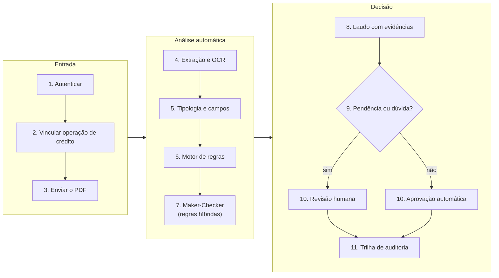

# Requisitos de Negócio e Especificações Funcionais

Este documento detalha o conjunto formal de requisitos funcionais (RF01 a RF15), requisitos não funcionais e as dores operacionais mapeadas a partir da Consulta Pública BNDES nº 01/2025.

---

## 1. Dores Operacionais Identificadas no BNDES

O processo tradicional de verificação de conformidade cadastral e documental em operações de crédito e financiamento apresenta desafios severos:

- **Elevado Volume Documental**: Múltiplas certidões, contratos sociais, balanços e licenças por proponente.
- **Heterogeneidade Estrutural**: Informações espalhadas em texto livre, tabelas financeiras, carimbos e PDFs digitalizados de baixa resolução.
- **Consultas Fragmentadas**: Necessidade de cruzar dados com certidões federais, estaduais, FGTS, CNDT e registros de falência.
- **Vulnerabilidade a Erro Humano**: Fadiga em conferências repetitivas pode resultar na aprovação inadvertida de certidões vencidas.
- **Dificuldade de Auditoria**: Reconstituir o conjunto probatório que fundamentou uma aprovação de anos anteriores demanda desarquivamento manual moroso.

---

## 2. Jornada do Usuário Analista

---

## 3. Catálogo de Requisitos Funcionais (RF01 a RF15)

| ID       | Requisito Funcional                | Prioridade  | Critério de Aceite Formal                                                                                    |
| :------- | :--------------------------------- | :---------- | :----------------------------------------------------------------------------------------------------------- |
| **RF01** | **Autenticação e RBAC**            | Alta        | Suporte a autenticação segura por token JWT com perfis segregados: `Admin`, `Analista`, `Auditor`.           |
| **RF02** | **Ingestão e Armazenamento**       | Alta        | Upload de arquivos PDF de até 50MB, validação binária (`%PDF-`) e persistência durável no MinIO S3.          |
| **RF03** | **Pipeline IDP e OCR**             | Alta        | Extração vetorial com fallback automático para OCR Tesseract em páginas digitalizadas (`CER <= 2.5%`).       |
| **RF04** | **Estruturação de Entidades**      | Alta        | Reconhecimento de CNPJ, razões sociais, datas de emissão, datas de validade e códigos de controle.           |
| **RF05** | **Checklist Declarativo**          | Alta        | Carregamento dinâmico de checklists versionados em JSON Schema sem necessidade de rebuild da aplicação.      |
| **RF06** | **Motor de Regras Determinístico** | Alta        | Validação booleana e temporal de certidões (CND, CRF, CNDT, Falência) com tolerância zero a pendências.      |
| **RF07** | **Maker-Checker Assistido por IA** | Alta        | Avaliação semântica de cláusulas jurídicas com citação literal compulsória de evidência documental.          |
| **RF08** | **Exibição de Evidências**         | Alta        | Interface destacando o trecho exato e página do documento original que fundamentou a classificação.          |
| **RF09** | **Revisão Humana e Exceções**      | Alta        | Fluxo operacional para analista aprovar, rejeitar ou deferir exceção justificada com parecer técnico formal. |
| **RF10** | **Trilha de Auditoria Imutável**   | Alta        | Gravação transacional de todos os eventos com timestamp UTC, ID do executor, hash do arquivo e laudo.        |
| **RF11** | **Relatório Consolidado**          | Media       | Exportação de laudo pericial em formato PDF/JSON estruturado para órgãos de controle externo (TCU/CGU).      |
| **RF12** | **Dashboard de Acurácia**          | Media       | Painel analítico exibindo indicadores de acurácia, recall, CER, tempo médio e taxa de revisão manual.        |
| **RF13** | **Camada de Conectores Externos**  | Media       | Integração modular com adaptadores de APIs governamentais (Receita Federal, Caixa, TST, Juntas).             |
| **RF14** | **Alertas e Notificações**         | Baixa/Media | Disparo de alertas preventivos sobre certidões próximas do vencimento durante a vigência do contrato.        |
| **RF15** | **Agendamento e Reprocessamento**  | Baixa       | Execução periodica automatizada via Celery Beat para revalidação de proponentes ativos na carteira.          |

---

## 4. Requisitos Não Funcionais (RNF)

- **RNF01 - Segurança**: Comunicação integralmente cifrada em trânsito (TLS 1.3) e segredos gerenciados via variáveis de ambiente auditadas pelo Gitleaks.
- **RNF02 - Desempenho**: Tempo de extração e avaliação de certidões fiscais inferior a 5 segundos por página.
- **RNF03 - Rastreabilidade**: Imutabilidade da trilha de auditoria; nenhum registro de decisão pode ser alterado ou removido (`append-only`).
- **RNF04 - Disponibilidade**: Arquitetura stateless para a camada de API e workers, permitindo escalabilidade horizontal em containers Docker.
- **RNF05 - Soberania e Privacidade**: Hospedagem e processamento estritamente em território nacional, em conformidade com a LGPD e resoluções do CMN.
- **RNF06 - Testabilidade**: Cobertura de testes unitários e de integração >= 70% e aprovação obrigatória de 100% no benchmark de Evals.
